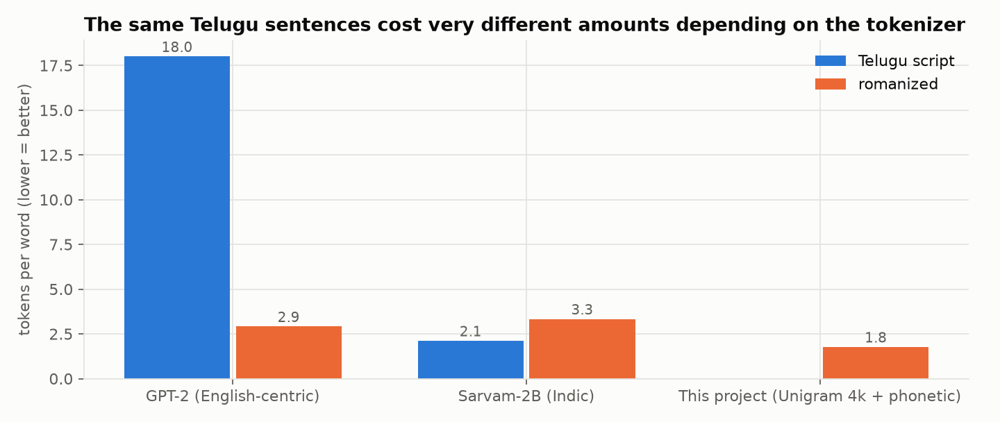
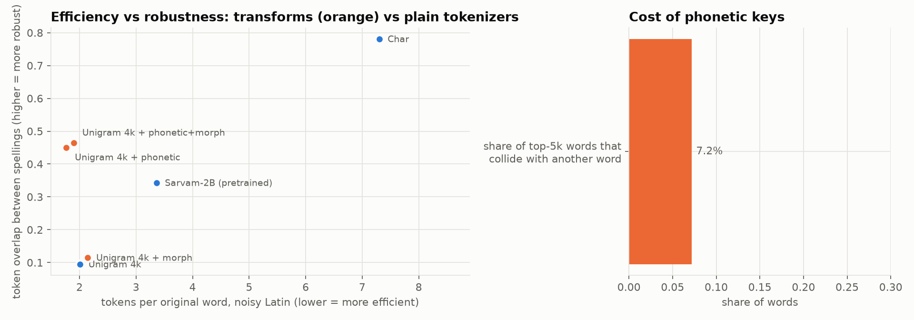
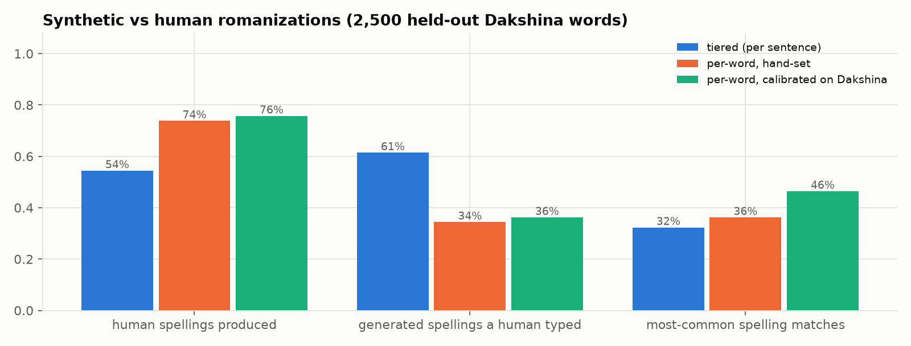
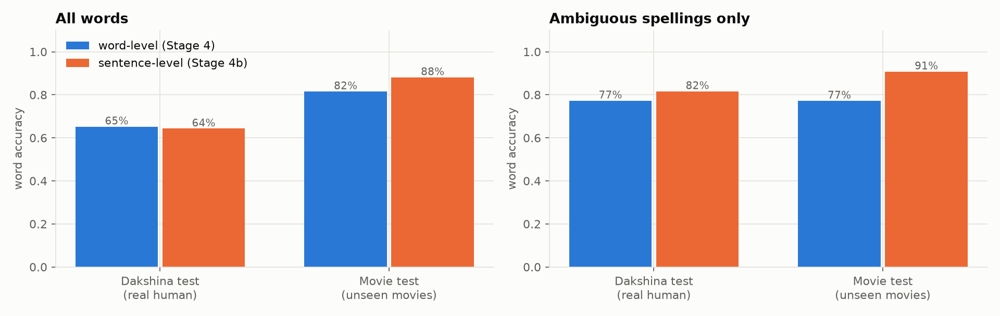
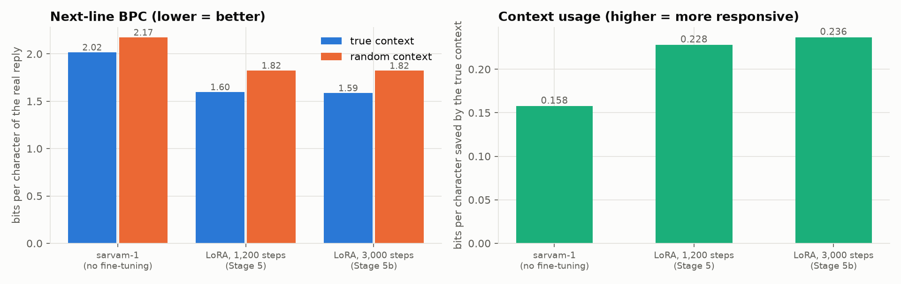
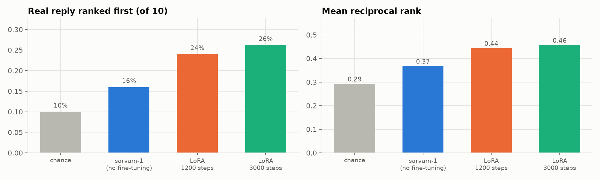
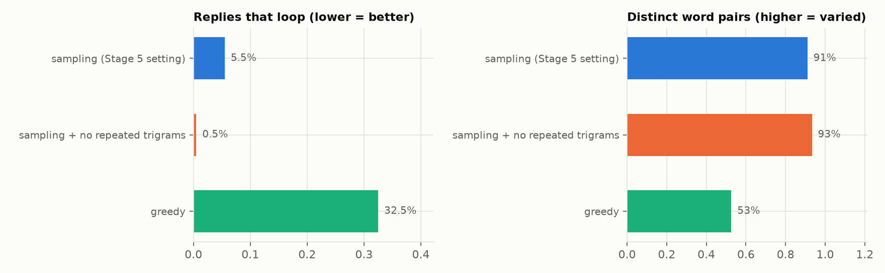

# tenglish-lm: a small AI that understands Telugu the way people actually type it

> **About this project.** This is a **learning project**. Its main aim is to understand, hands-on, **how language models are built,
> trained, fine-tuned and evaluated**, from tokenizers and small models trained from scratch up to fine-tuning an open model and comparing it
> with frontier systems. It's a small guided project **inspired by the Google DeepMind AI Foundations course**, for **research and
> educational purposes only**. It is not a product, and it is not affiliated with Google, DeepMind, Sarvam AI, Anthropic or any other
> organisation mentioned. Movie subtitles and YouTube comments are used only to compute statistics and to train or evaluate
> experimental models; they are **not** redistributed here, and the trained weights are kept private.
>
> **For a deeper understanding of the problem** (Indian languages written in the Latin script), read Google Research's **Dakshina**
> study, which this project builds on: B. Roark et al., *"Processing South Asian Languages Written in the Latin Script: the Dakshina
> Dataset"*, LREC 2020 ([dataset and paper](https://github.com/google-research-datasets/dakshina)).

---

## The problem, in one minute

Millions of Telugu speakers chat in **English letters**, mixed with English words, with **no spelling rules**:

```
"enti ra intha late ayyindi?"      "yenti ra inta lete?"      "anti ra inta late?"
```

All three mean the same thing: **ఏంటి రా ఇంత లేట్ అయ్యింది?**, "Why are you so late, man?"

That's hard for AI models, for three reasons:
1. **Spelling chaos:** `enti`, `yenti` and `anti` look like three different words to a computer.
2. **Formal training data:** most Telugu text that models learn from (news, Wikipedia) is formal and in Telugu script, not how people talk.
3. **Size:** big chat models (ChatGPT, Gemini, Claude) can handle this, but they're huge and remote for such a narrow job.

**Goal: learn how such a system is built by actually building one: a *small* model that understands romanized, mixed, spoken Telugu typed
any way, and replies in natural, everyday Telugu.**
It's built step by step, measuring each step, using the dialogue of 76 Telugu movies (2000–2025) as a record of how people really talk.

---

## How it works

```
 you type (any spelling)         1. spot English words      2. fix the spelling          3. reply                    4. show it
 "bro exam ela rasav?"   ──►    "bro", "exam" stay   ──►   ఎలా రాసావ్?   ──►   small fine-tuned model  ──►   Telugu script
                                 as they are                (Telugu script)       writes the next line      or readable romanized
```

| Step | What it does | The model behind it | Size |
|---|---|---|---|
| 1. English detector | decides, word by word, whether it's English or Telugu | letter-pattern classifier (Naive Bayes) | tiny |
| 2. Spelling normalizer | turns any romanized spelling into proper Telugu script, using the whole sentence as context | small transformer, **built from scratch** | 7.6M parameters |
| 3. Reply model | writes the next line of the conversation in spoken Telugu | **sarvam-1** (an open Indian-language model), **fine-tuned** on movie dialogue | 2.5B + 24M trained |
| 4. Output | writes the reply back in Telugu script or clean romanized Telugu | fixed rules | — |

---

## The key ideas, explained simply

### What is a "token", and why does it matter for Telugu?
AI models don't read letters or words; they read **tokens**, small chunks of text from a fixed list. `"intha late enduku"` might become
`intha · late · enduku` (3 tokens) or `in · th · a · la · te · end · uku` (7 tokens). **Fewer tokens = faster, cheaper, and the model sees
more context.**

Many popular models were built mainly for English, so they cut Telugu into tiny pieces. This project measured it on the same sentences:

| Tokenizer | Tokens per Telugu word | Tokens per romanized word |
|---|---|---|
| GPT-2 (English-focused) | **18.0** | 2.9 |
| Sarvam-2B (built for Indian scripts) | **2.1** | 3.3 |
| This project's tokenizer | — | **1.8** |

Indian-language models like Sarvam fix the *script* problem (8× better than GPT-2), but they're no better on *romanized* text,
which is how most people actually type.

### Why does spelling make it harder?
If `enti`, `yenti` and `anti` become three unrelated tokens, the model has to learn three times that they mean the same thing. This
project tested several fixes and found that a simple **phonetic key** (treating `th`=`t`, `aa`=`a`, `w`=`v`, doubled letters = single)
makes spellings **4.5× more consistent** while also using fewer tokens. The best overall solution was a dedicated **spelling normalizer**
(step 2 above) that turns any spelling into Telugu script before anything else happens.

### Where did training data come from?
- **Telugu movie dialogue** from YouTube subtitles: 54,656 lines from 76 movies. Real spoken Telugu.
- **Synthetic romanized text:** the movie lines, re-typed in many random but realistic spellings by a "romanizer" whose habits were
  **measured from real people's typing** (Google's Dakshina dataset).
- **Real human romanizations** (Dakshina): Telugu words and sentences typed in English letters by native speakers.

### What does "fine-tuning" (LoRA) mean?
Instead of building a large model from zero (impossible with 1.2M words of data), we take an existing open model (**sarvam-1**) and adjust
it a little. **LoRA** freezes the original 2.5 billion numbers and trains a small add-on of 24 million (about 1%), which was enough to change
the model from answering like a news site to talking like a movie character.

### How do you test replies when there's no single right answer?
For "why are you so late?", *traffic*, *I overslept* and *why do you care?* are all good replies. So no single test is used. Instead there are several:
- Where a correct answer **does** exist (spelling → Telugu script), it's checked directly against human data.
- The reply that **actually** came next in the movie is one good answer: how strongly does the model expect it, and can it pick it out of
  10 options?
- **Behaviour checks:** does the model react to what was said, avoid repeating itself, and understand 4 spellings of the same message the same way?
- **A judge model** (Claude, and Sarvam-M) compares replies. The judge is **tested first** on an easy case (real reply vs a random one).

---

## Results at a glance

| Question | Answer | Details |
|---|---|---|
| How badly do common tokenizers handle Telugu? | GPT-2 needs 18 tokens per Telugu word; Sarvam 2.1; on romanized text, a tokenizer trained on this data needs 1.8 | [Stage 2](docs/STAGES.md#stage-2-which-tokenizer-stagess2_tokenizer_studypy) |
| Can we fake realistic typing? | Yes: the generator produces **76%** of real human spellings, with habits measured from Dakshina | [Stage 1c](docs/STAGES.md#stage-1c-benchmark-against-real-human-spellings-stagess1c_dakshina_benchmarkpy) |
| Can a small model fix spelling? | **68%** of words exactly right on real human typing, **91%** on ambiguous words in movie sentences, **9%** for a dictionary lookup on unseen words | [Stage 4, 4b](docs/STAGES.md#stage-4-a-spelling-normalizer-trained-from-scratch-tlmseq2seqpy-stagess4_preparepy-stagess4_normalizerpy) |
| …and how does Claude do on the same task? | **87%**, still clearly better than our 7.6M-parameter normalizer | [Stage 6](#stage-6-in-progress) |
| Does fine-tuning make replies sound like real dialogue? | Yes: real next lines become **21% less surprising** to the model, and it uses context **50% more** | [Stage 5, 5b](docs/STAGES.md#stage-5-a-spoken-style-reply-model-stagess5_preparepy-stagess5_dialogue_lmpy) |
| Can it pick the real reply out of 10? | **26%** of the time (chance: 10%; untuned model: 16%) | [Stage 5c](docs/STAGES.md#stage-5c-evaluating-the-whole-system-automatically-stagess5c_evaluationpy) |
| Does a judge prefer the fine-tuned replies? | Claude (which passed its reliability test 91% of the time) preferred them over the untuned model's in **94%** of pairs | [Stage 6](#stage-6-in-progress) |
| Does it still loop or repeat itself? | **0.5%** of replies, with the right generation settings (32% with the naive setting) | [Stage 5b](docs/STAGES.md#stage-5b-better-replies-stagess5b_better_repliespy) |


### In pictures

**1. Tokenizers:** English-focused GPT-2 shreds Telugu script (18 tokens per word). Sarvam fixes the script, but not romanized typing.


**2. Spelling robustness:** a simple phonetic key (orange) makes different spellings share tokens without costing efficiency.


**3. Realistic fake typing:** synthetic spellings checked against real people's spellings from Google's Dakshina dataset.


**4. Fixing spelling:** reading the whole sentence (orange) resolves ambiguous words much better than word by word.


**5. Replies:** fine-tuning makes real dialogue less surprising to the model, and makes it respond more to what was said.


**6. Picking the real reply out of 10** (chance is 10%):


**7. No more loops:** blocking repeated 3-word phrases nearly eliminates repetitive replies.


### What it can do now
| You type | It understands | It replies |
|---|---|---|
| `nuvvu naaku nachchav` | నువ్వు నాకు నచ్చావ్ *(I like you)* | `nannu premisthunnaava?` *(do you love me?)* |
| `repu movie ki veldama?` | రేపు movie కి వెళ్దామా? *(movie tomorrow?)* | `… sare veldaam` *(… ok, let's go)* |
| `sorry ra, traffic lo stuck ayya` | sorry రా, traffic లో stuck అయ్యా | `nuvvu bas ekkuthaava …` *(will you take the bus? …)* |

### Honest limitations
- Replies are often **generic or drift off-topic**; this is a small model with a short training budget.
- The spelling normalizer is still **well behind Claude** (68% vs 87% of words on real typing).
- The romanized training data is **synthetic** (realistic, but generated), and movie dialogue is scripted, not everyday chat.
- English words are detected about 96% of the time; very short chat words (`hi`, `ok`) need a small fixed list.

---

## Stage 6 (in progress)

Testing on **real-world** data and against **frontier models**:
- **4,071 real romanized-Telugu YouTube comments** (kept locally, never committed) test whether the system holds up on genuine typing.
- **Claude** (through its command-line app) and **ChatGPT / Gemini** (through their apps) are compared on the same tasks.
- **Sarvam-M** acts as an independent judge.

First results from Claude:
- It converts **87%** of words in real romanized sentences to the correct Telugu.
- As a judge, it picks the real movie reply over a random one **91%** of the time, so it can be trusted.
- It prefers our fine-tuned replies over the untuned model's in **94%** of pairs.

The remaining results will be added as they arrive.

---

## The full story

- **[docs/STAGES.md](docs/STAGES.md):** the complete lab notebook. Every stage, plot, number and mistake, in the order the project was built.
- **[docs/DATA_CARD.md](docs/DATA_CARD.md):** where the data comes from, how it was cleaned and what's inside.
- **[docs/ROMANIZATION.md](docs/ROMANIZATION.md):** exactly how the synthetic romanized text is generated.
- **[docs/MODELS.md](docs/MODELS.md):** every model used, its architecture and its size.
- **[Google's Dakshina study](https://github.com/google-research-datasets/dakshina):** the research background on Indian languages written in Latin script.

| Stage | Question | Status |
|---|---|---|
| 0 / 0b | What's in the data? | ✅ |
| 1 / 1b / 1c | Can we simulate how people type, and does it match real typing? | ✅ |
| 2 / 2b | Which tokenizer handles Telugu and messy spelling? | ✅ |
| 3 | Does the tokenizer change how well a small model learns? | ✅ |
| 4 / 4b | Spelling normalizer (word-level, then sentence-level with English detection) | ✅ |
| 5 / 5b / 5c | Reply model (sarvam-1 + LoRA), better decoding, automatic evaluation | ✅ |
| 6 / 6b | Real-world comments, judged replies, comparison with frontier models | 🔄 |
| 7 | Reproducible demo script (weights kept private) | planned |

## What you can do with this repository (no 5 GB download needed)

The trained weights are private, and a 2.5B-parameter model isn't something most visitors want to download anyway. Here's what you
*can* do, from easiest to most involved:

| You want to… | Do this | Needs |
|---|---|---|
| **See how the models behave** | read [docs/eval/](docs/eval/): the exact prompts, plus every model's answer side by side (ours, untuned, Claude, Gemini) on the same test items | a browser |
| **Play with the core ideas in seconds** | `python examples/quickstart.py`: realistic spelling variants, the phonetic key, and tokenizers trained on the spot | Python + `sentencepiece` |
| **Understand each step** | [docs/STAGES.md](docs/STAGES.md) walks through every stage with plots and the reasoning, including the mistakes | a browser |
| **Rebuild the models yourself** | build a corpus with `extractor/`, then run `stages/` in order; the GPU stages run on free or paid Google Colab | Colab, a few hours |
| **Reuse it for another language** | the romanizer, phonetic key, normalizer and evaluation code are language-agnostic in design (e.g. Hinglish, Tamil, Kannada) | your own data |

## Model weights

The trained weights are **not published**. The reply model was trained on movie subtitles (copyrighted material), and this is a
research and learning project, so the weights are kept private. Everything needed to **reproduce** them is here: the code, the
data-building scripts, and every training setting. Each stage script lists its inputs, and `docs/STAGES.md` records the settings and results.

## Run it yourself

```bash
pip install -r requirements.txt
export TLM_CORPUS=/path/to/movie_corpus     # built with extractor/ (YouTube subtitles → scenes)
python stages/s0_corpus_stats.py            # each stage is one script; see docs/STAGES.md for the full list
```
GPU stages (3–6) were run on Google Colab (T4 / L4 / A100). Each script's header lists its inputs and outputs.

| Folder | Contents |
|---|---|
| `extractor/` | YouTube Telugu subtitles → cleaned, scene-segmented corpus |
| `tlm/` | the library: romanizer, filters, phonetic key, English detector, tiny GPT, seq2seq normalizer |
| `stages/` | one script per stage |
| `docs/` | plots, result files, the detailed stage write-up, the data card and the romanization rules |

---

## Glossary

| Term | Plain meaning |
|---|---|
| **Romanized Telugu / Tenglish** | Telugu written in English letters, often mixed with English words |
| **Token / tokenizer** | the small text chunks a model reads, and the tool that cuts text into them |
| **Fertility** | tokens per word; lower means more efficient |
| **BPE / Unigram** | two standard ways of building a tokenizer's chunk list |
| **Phonetic key** | a simplified spelling that merges choices like `th`/`t` and `aa`/`a` |
| **Normalizer** | the model that turns any spelling into proper Telugu script |
| **Transformer** | the neural-network design behind modern language models |
| **Fine-tuning / LoRA** | adapting an existing model with a small amount of extra training; LoRA trains a small add-on instead of the whole model |
| **Bits per character (BPC)** | how surprised a model is by real text; lower means it predicts real text better |
| **Decoding** | how a model turns its predictions into actual text (greedy, sampling, …) |
| **Judge model** | a strong model asked to compare two replies, itself checked on cases where the answer is known |
| **Dakshina** | a public Google Research dataset of Indian-language text typed in English letters by native speakers |
| **Sarvam-1 / Sarvam-M** | open Indian-language models from Sarvam AI (2B and 24B parameters) |
