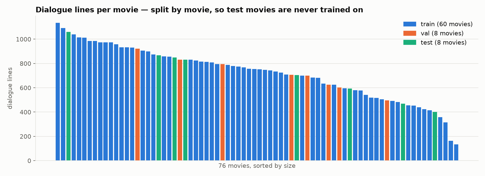
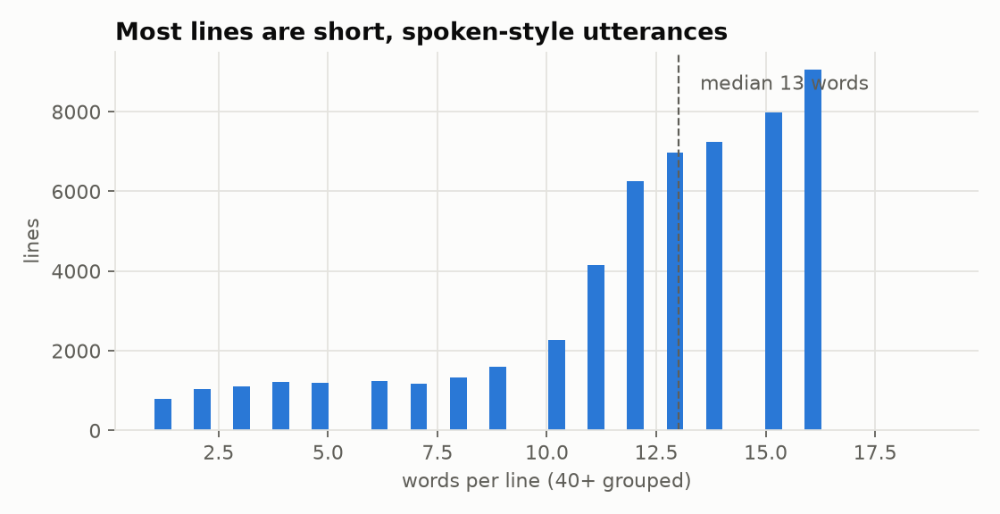
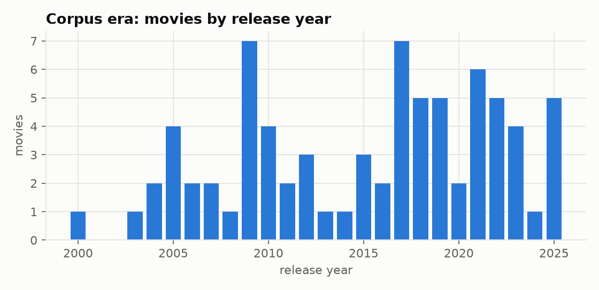
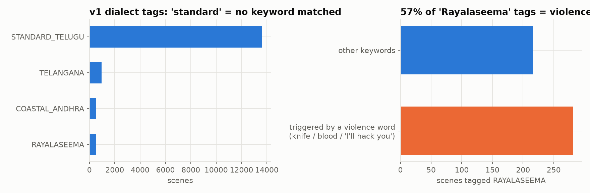
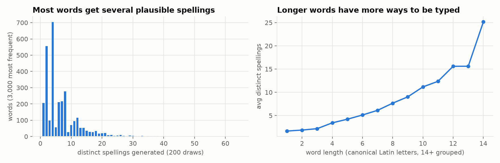
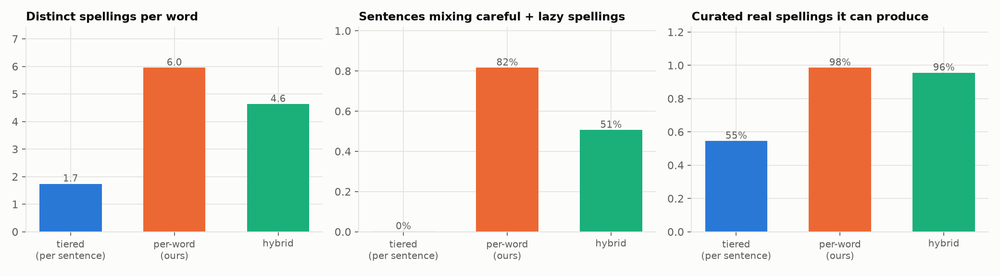
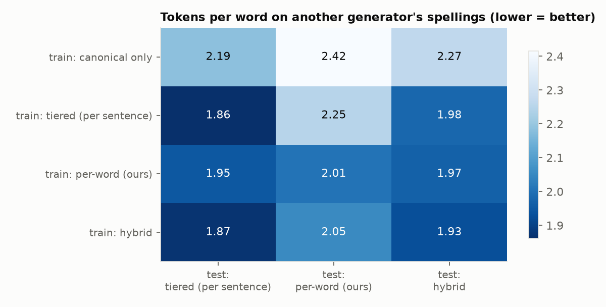
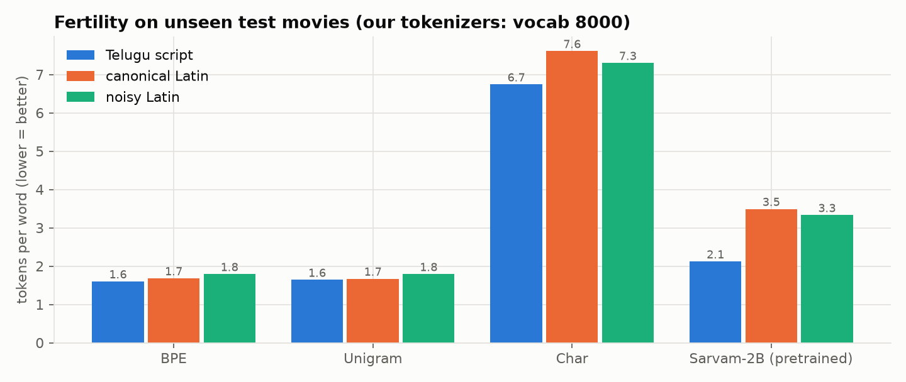
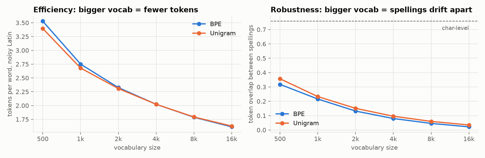

# tenglish-lm: towards a lightweight model for spoken, romanized Telugu

> **About this project.** This is a small, guided learning project based on the **Google DeepMind AI Foundations** course.
> It is intended **for research and educational purposes only**. It is not a product and is not affiliated with Google, DeepMind,
> Sarvam AI or any other organisation named here. Movie subtitles are used only to compute statistics and train
> experimental models; they are **not** redistributed in this repository.

## In one paragraph

Millions of people write Telugu online, but rarely the way textbooks do. They type it **in Latin letters** (`enti ra, intha late?`),
**mix in English** (`exam ela rasav?`), and use **spoken, colloquial forms** rather than formal written Telugu. No spelling standard exists:
the same word can be typed `enti`, `yenti` or `anti`. Large AI models are trained mostly on formal, native-script text and are far bigger
than this narrow task needs. This project studies the problem step by step, starting with the most basic question
(**how should a model even split this text into pieces?**), and builds towards a small model that understands romanized,
code-mixed, spoken Telugu and can **convert between** native script, romanized Telugu and everyday spoken style.

---

## 1. Background for first-time readers

### How Telugu appears online

| Form | Example | Who writes it |
|---|---|---|
| Native script, formal | నువ్వు పరీక్ష ఎలా రాశావు? | news, books, Wikipedia |
| Native script, spoken | నువ్వు ఎగ్జామ్ ఎలా రాసావ్? | movie subtitles, some social media |
| **Romanized (Latin script)** | `nuvvu exam ela rasav?` | most chat, comments and posts |
| **Romanized + English mixed** | `bro exam ela rasav, results eppudu?` | very common among younger users |

The last two rows are the focus here. They're everywhere in real use, and they're under-served by language models.

### What is tokenization, and why does it matter?

A language model doesn't read letters or words. It reads **tokens**: pieces of text from a fixed vocabulary. A **tokenizer** decides
how text is cut into tokens before the model ever sees it. For example:

```
"intha late enduku?"  ->  ["▁intha", "▁late", "▁enduku", "?"]        (4 tokens: efficient)
                      ->  ["▁in", "th", "a", "▁la", "te", "▁end", ...]  (many tokens: expensive)
```

Fewer tokens per word (**fertility**) means the model can read more context, runs faster and costs less. A tokenizer that chops a
language into tiny fragments makes every model built on it slower and worse at that language.

### Why Telugu is hard to tokenize

1. **It's an abugida.** Each written syllable (*akshara*) combines a consonant, vowel signs and sometimes stacked consonants: క్ష్మ.
   In Unicode, one visible syllable is several code points, and each code point is **3 bytes**. Tokenizers built mostly
   for English fall back to bytes, so Telugu explodes into many tokens.
2. **It's agglutinative.** Words grow by stacking suffixes: `illu` (house) → `intlo` (in the house) → `intloki` (into the house).
   A vocabulary has to cover many forms of every word.
3. **Romanized Telugu has no spelling rules.** ఏంటి is `enti` / `yenti` / `anti`; దగ్గర is `daggara` / `dhaggara` / `dagara`.
   A tokenizer that learns `enti` as one token may treat `yenti` as something completely different.
4. **Code-mixing.** English words appear in the middle of Telugu sentences (`late`, `exam`, `sir`), sometimes spelled in Telugu script (లేట్).

### How much this costs in practice (measured on this project's test movies)


- **GPT-2** (an English-centric tokenizer) needs **~18 tokens for each Telugu-script word**: it is effectively reading raw bytes.
- **Sarvam-2B**, an Indic-language model from Sarvam AI with a tokenizer designed for Indian scripts, needs **~2.1**: about **8× more efficient**.
  This is why Indic-specific models matter.
- **But on romanized Telugu, Sarvam's advantage disappears (3.3 tokens per word, worse than GPT-2's 2.9).** Its tokenizer was built
  for native script, while most people type in Latin letters. Sarvam splits `chesanu` into `c` `hes` `an` `u`.
- A small tokenizer trained on this project's corpus (**Unigram 4k + phonetic key**, Stage 2 below) needs **~1.8**.

### Where current models fall short (observations from this project)

- **Register:** pretrained models often answer spoken prompts in formal, essay-like Telugu. In an early experiment, an untuned base model
  continued a movie line with encyclopedia-style text and emoji lists.
- **Romanized input:** tokenizers optimized for native script fragment romanized text (above).
- **Spelling variation:** with nothing tying `enti` to `yenti`, a model has to learn each spelling separately.
- **Dialects:** regional speech (Telangana, Rayalaseema, coastal) is under-represented, and this project found that simple
  keyword-based dialect labels are unreliable (Stage 0).
- **Size:** general frontier models can do much of this, but they're large and remote for what is essentially a narrow conversion task.

### Related work by other labs (other languages and settings)

This problem isn't unique to Telugu. Similar efforts include:

| Work | By | What it does |
|---|---|---|
| **Dakshina dataset** | Google Research | Native-script and romanized text for 12 South Asian languages, including Telugu; a benchmark for transliteration |
| **Aksharantar / IndicXlit** | AI4Bharat (IIT Madras) | A large transliteration dataset and models between Latin and Indic scripts |
| **IndicTrans2** | AI4Bharat | Translation models for 22 scheduled Indian languages |
| **MuRIL** | Google | A multilingual Indian-language model that also trains on transliterated (romanized) text |
| **GLUECoS** | Microsoft Research India | A benchmark for code-switched NLP, including Hindi–English ("Hinglish") |
| **LinCE** | academic collaboration | A benchmark for code-switching across several language pairs |
| **Sarvam-1 / Sarvam-2B** | Sarvam AI | Small Indic-focused language models with Indic-optimized tokenizers |
| **Arabizi research** | various | Arabic written in Latin letters with numbers (`3`, `7`): the same "no spelling standard" problem in another language |

This project differs in focus: **spoken, contemporary, romanized Telugu**, with a deliberately **small** model, built stage by stage for learning.

---

## 2. What this project builds

```
 any spelling, mixed with English                                                  consistent output
 "anti ra inta lete?"  ──► normalize spelling ──► tokenizer ──► small model ──►  "enti ra, intha late enduku?"
 "yenti ra intha late?"     (phonetic key)        (Unigram)    (trained on        or  ఏంటి రా, ఇంత లేట్ ఎందుకు?
                                                                spoken Telugu)
```

The long-term goal is a **small converter / language model** that:
1. **understands** Telugu however it's typed (native script, romanized with any spelling, mixed with English);
2. **converts** between native script ⇄ readable romanized Telugu, and formal ⇄ spoken style;
3. **writes** in natural, contemporary, spoken Telugu.

**The data:** the dialogue of 76 Telugu movies (2000–2025), extracted from public YouTube subtitles with `extractor/`. Movie
dialogue is one of the largest available records of *spoken* Telugu.

---

## 3. Stages and results

Every stage is one script in `stages/`, and each writes its plots to `docs/plots/` and its numbers to `docs/results/`.

### Stage 0: understand the data (`stages/s0_corpus_stats.py`)

76 movies, 15,597 scenes, **54,656 dialogue lines, 658k words**. The median line is 13 words: short, spoken utterances.



The data is **split by movie** (60 train / 8 validation / 8 test). Every line from a test movie is unseen during training, so
scores measure generalization rather than memorization.

 

**Finding: automatic keyword labels can't be trusted.** An earlier version tagged dialect by keyword matching. 87% of scenes fell
back to "standard", and **57% of "Rayalaseema" tags were triggered by violence words** (knife, blood) rather than by how anyone speaks.
Those labels are not used.



### Stage 0b: data card (`stages/s0b_data_card.py`, full details in [docs/DATA_CARD.md](docs/DATA_CARD.md))

What the corpus actually is, and what to keep in mind when reading every later number:

- **Cleaning funnel:** 177,815 raw subtitle blocks → 161,925 after cleaning → merged into 54,989 dialogue turns →
  **51,662 turns** after quality filters (979 scenes removed, mostly leftover sound/music tags).
- **A "line" is a dialogue turn, not one speaker.** 33% of turns contain more than one sentence.
- **Caption quality:** 13 of 76 movies have almost no punctuation, which points to auto-generated (speech-recognition) captions.
- **English inside Telugu:** between **3% and 13%** of Telugu-script words are English loanwords (సార్, ఫోన్, ప్లీజ్).
- **Vocabulary:** 64% of words appear only once, and **11.5% of words in the test movies never occur in training**.
  Word-level vocabularies can't work here.


### Stage 1: simulate how people type (`tlm/romanizer.py`, `stages/s1_romanizer.py`)

Real romanized data is scarce, so the project generates it. The romanizer converts Telugu script to Latin letters by choosing
**one realistic spelling per sound, independently for each word**, from observed alternatives (`aa`/`a`, `th`/`t`, `v`/`w`, `e`/`ye`…).
It also gives each sentence a "typing habit", from careful (`raasaanu`) to lazy (`rasa`). English loanwords stay in English.



| Telugu | canonical | generated spellings |
|---|---|---|
| కాదు | `kaadu` | `kaadu`, `kaadhu`, `kadu`, `kadhu` |
| నువ్వు | `nuvvu` | `nuvvu`, `nuwwu`, `nuvu`, `nuwu` |
| లేదు | `ledu` | `ledu`, `ledhu`, `leedu` |

Frequent words get **~6.7 different spellings** on average, including chat shorthand (`nen`, `nuvv`, `enty`, `chesa`).
The complete rules and probabilities are in [docs/ROMANIZATION.md](docs/ROMANIZATION.md); more examples in
[docs/results/s1_examples.md](docs/results/s1_examples.md).

### Stage 1b: which way of generating synthetic text? (`tlm/tiers.py`, `stages/s1b_generator_comparison.py`)

There's more than one way to fake human typing. Three strategies were compared:

| Strategy | How it varies | Assumption |
|---|---|---|
| **Tiered** (a design proposed by Gemini) | one fixed style **per sentence**: P1 standard, P2 minimal, P4 lazy | each person types consistently |
| **Per-word** (this project) | every **word** gets its own random spelling, plus a per-sentence habit | people aren't consistent, even within a sentence |
| **Hybrid** | a tier per sentence, with 30% of words re-sampled per word | somewhere in between |



- **Diversity:** the tiered approach gives only ~1.7 spellings per word; per-word gives ~6.
- **Mixing:** real messages often mix careful and lazy spellings (`intha late ayyindi, nuvu chepu`). Tiered sentences never do (0%);
  per-word sentences do 82% of the time.
- **Curated real spellings:** against a small hand-curated list of common real spellings ([tlm/reference_spellings.py](tlm/reference_spellings.py)),
  the tiered approach produces 55%. Per-word produced 86% before calibration and **98.5% after shorthand rules were added**.
  *Caution:* the rules were calibrated against this same list, so the post-calibration number isn't an independent test.

**The more useful test: does training on one generator prepare a tokenizer for another generator's spellings?**



A tokenizer trained on **tiered** text handles tiered text well (1.86 tokens per word) but struggles with per-word spellings (2.25).
A tokenizer trained on **per-word** text is nearly equally good on all three (1.95–2.01). Training only on canonical spellings is worst everywhere.
**Per-word generation is kept as the default**, because it prepares the model for spelling styles it hasn't seen. The hybrid is a close second.

### Stage 2: which tokenizer? (`stages/s2_tokenizer_study.py`)

Tokenizers are trained on the training movies and scored on the test movies, on two measures:
- **Fertility:** tokens per word. Lower means more efficient.
- **Spelling consistency:** take 8 spellings of the same word and measure how many tokens they share. Higher means the
  model can more easily see that `enti` and `yenti` are the same word.

Three tokenizer types:
- **BPE:** repeatedly merges the most frequent pair of symbols. It's used by GPT models.
- **Unigram:** keeps a vocabulary of pieces with probabilities, and can *sample* different ways of splitting a word during training.
- **Character:** one token per letter.



**Finding 1: a corpus-trained tokenizer is about 2× more efficient than Sarvam's on romanized text** (1.8 vs. 3.3 tokens per word).

**Finding 2: efficiency and spelling robustness pull in opposite directions.** With a large vocabulary, each spelling becomes its own
whole-word token (`enti`, `yenti` and `anti` share nothing). Smaller vocabularies share more pieces but need more tokens.
Characters are the most robust (0.76 overlap), but cost ~7 tokens per word. ([segmentation examples](docs/results/s2_segmentations.md))



**Finding 3: a phonetic key gets around the trade-off.** Before tokenizing, spelling choices that don't change meaning are collapsed
(`th→t`, `dh→d`, `aa→a`, `w→v`, doubled letters → single, initial `ye→e`). Then `yenti`/`enti` and `intha`/`inta` become identical.

| Method (Unigram, 4k vocab) | tokens per word ↓ | spelling consistency ↑ |
|---|---|---|
| plain | 2.02 | 0.10 |
| + morphology split (`intlo → int ##lo`) | 2.16 | 0.12 |
| **+ phonetic key** | **1.77** | **0.44** |
| + phonetic key + morphology | 1.90 | 0.46 |
| Character-level (reference) | 7.30 | 0.76 |
| Sarvam-2B pretrained (reference) | 3.33 | 0.33 |

The phonetic key makes text **~4.5× more spelling-robust and more efficient at the same time**. Morphology splitting alone barely helps.


**The cost:** **7.2%** of common words collapse onto another real word: `nee`/`ni` ("you" vs "your"), `oka`/`okka`,
`vaadu`/`vaddu` ("he" vs "don't"). The model then has to tell them apart from context. Full list: [docs/results/s2_phonetic_collisions.md](docs/results/s2_phonetic_collisions.md)

**Current choice:** Unigram (4k) with the phonetic key for input. Stage 3 tests whether this actually helps a model learn.

---

## 4. Roadmap

| Stage | Question | Status |
|---|---|---|
| 0 / 0b | What's in the corpus? (data card) | ✅ |
| 1 / 1b | Can we simulate how people type Telugu? Which generator is best? | ✅ |
| 2 / 2b | Which tokenizer handles messy spelling? | ✅ |
| — | Validate the romanizer against human romanizations (e.g. Google's Dakshina) | planned |
| 3 | Tiny language models from scratch: does the tokenizer choice change perplexity on unseen movies? | next |
| 4 | Normalizer / converter: any spelling → native script and canonical romanized (small character model, from scratch) | planned |
| 5 | Spoken-style model: fine-tune a small pretrained model on dialogue (line → next line) | planned |
| 6 | Real-world test set of romanized Telugu typed by people | planned |
| 7 | Public demo | planned |

## 5. Run it yourself

```bash
pip install -r requirements.txt
export TLM_CORPUS=/path/to/movie_corpus       # built with extractor/ (see extractor/01_YouTube_Movie_Corpus_Extractor.ipynb)
python stages/s0_corpus_stats.py
python stages/s0b_data_card.py
python stages/s1_romanizer.py
python stages/s1b_generator_comparison.py
python stages/s2_tokenizer_study.py --sarvam path/to/sarvam-2b/tokenizer.json
python stages/s2b_reference_tokenizers.py --gpt2 path/to/gpt2/tokenizer.json --sarvam path/to/sarvam-2b/tokenizer.json
```

## Repository layout

| Path | Contents |
|---|---|
| `extractor/` | YouTube Telugu subtitles → cleaned, scene-segmented corpus (Colab notebooks + scripts) |
| `tlm/` | library: corpus loader, quality filters, romanizers (per-word, tiered, hybrid), phonetic key and morphology splitter, plot style |
| `stages/` | one reproducible script per stage |
| `docs/plots/`, `docs/results/` | every figure and number shown above |
| `docs/DATA_CARD.md`, `docs/ROMANIZATION.md` | detailed data description and romanization rules |
| `data/split_manifest.json` | the fixed movie-level train/val/test split |

## Limitations

- The romanized training text is **synthetic**: generated by hand-set rules from native-script subtitles, and **not yet validated
  against human romanizations**. Real typing habits may differ (Stage 6 and the Dakshina validation address this).
- Subtitles come partly from automatic speech recognition and contain errors and some song lyrics.
- Movie dialogue isn't everyday conversation: it's scripted and dramatized.
- For research and education only; see the note at the top.
