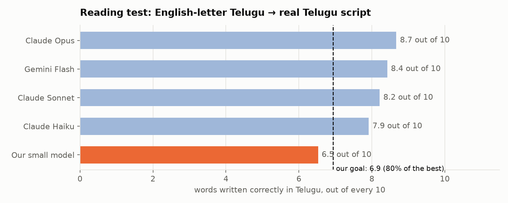
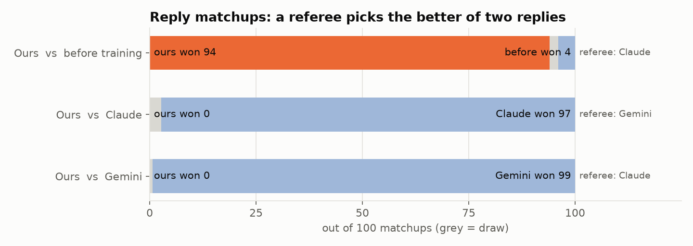

# tenglish-lm: teaching a small AI to read Telugu typed in English letters

> 📚 **A learning project.** It was built to understand, hands-on, how AI language models are made, trained and tested.
> It's inspired by the **Google DeepMind AI Foundations** course and is for **research and learning only**: not a product, and not
> linked to any company named here. The trained models are kept private.

---

## What's the problem?

Lots of people text in Telugu using **English letters**, like this:

> **`enti ra intha late ayyindi?`** → *"Why are you so late, man?"*

But everyone spells it differently:

> `enti` · `yenti` · `anti` → they all mean **ఏంటి** (*"what"*)

Computers get confused: to them, those look like three different words.

## What did we build?

A small AI helper that works in **3 steps**:

```
  1. READ            "enti ra intha late?"   →   ఏంటి రా ఇంత లేట్?      (fix the spelling, write it in Telugu)
  2. THINK & REPLY   ఏంటి రా ఇంత లేట్?      →   "Sorry ra, traffic!"   (answer like a real person would)
  3. SHOW            the reply in Telugu, or in English letters
```

To learn how people really talk, it studied the **dialogue of 76 Telugu movies**.

### Which parts are AI, and which are simple code?

| Part | What it does | AI or simple code? |
|---|---|---|
| **Spelling normalizer** (step 1) | reads messy English-letter text and writes proper Telugu | 🤖 **AI model**: a neural network trained **from scratch** in this project (7.6 million parameters) |
| **Reply model** (step 2) | writes the answer | 🤖 **AI model**: *sarvam-1*, an existing open AI (2.5 billion parameters), **fine-tuned** here on movie dialogue |
| **English detector** (part of step 1) | spots English words like `exam` so they're left alone | 📊 **simple statistics**: counts of letter patterns, not a neural network |
| **Romanizer** | turns Telugu into English letters in realistic random spellings, to **make practice data** for the normalizer and to show replies in English letters (step 3) | ⚙️ **simple code**: spelling rules plus percentages **counted** from real people's typing |
| **Phonetic key** | simplifies spellings (`th`→`t`, `aa`→`a`) for experiments | ⚙️ **simple code**: a few replace rules |

**In one sentence:** simple code *makes the practice data*, and the two AI models *learn from it* and do the real work.

## How do we test it? Two simple tests

**🔤 Test 1: the reading test** (like a school spelling test)
We give the AI 300 sentences typed in English letters. We already know the correct Telugu answers, so we just count:
*out of every 10 words, how many did it write correctly?*

**💬 Test 2: the reply matchup** (like a talent show with a referee)
Two AIs answer the same message. A **referee** (another, strong AI) reads both answers, without knowing who wrote which, and picks the
better one. We check the referee first on easy cases where we *know* the right answer, to make sure it isn't guessing.

## How did we do?

### 🔤 Reading test



- **Our small model gets about 6.5 words out of 10 right.**
- The big AIs (Claude, Gemini) get **8 to 9 out of 10**.
- 🎯 **Our goal:** reach **6.9 out of 10**, which is 80% of the best. We're close.

### 💬 Reply matchups



- After training, our model's replies **beat its old self 94 times out of 100**. The training clearly worked.
- But **Claude and Gemini still win almost every matchup** against us. Big AIs are still much better at chatting.

### 📏 But our model is small

| | Size | Runs on |
|---|---|---|
| **Our model** | about **2.5 billion** "brain connections" (parameters), plus a **tiny 7.6 million** one for spelling | one gaming PC, or a laptop |
| Claude, Gemini | not made public, but **much, much bigger** | giant data centres |

So the real question this project explores is: **how close can a *small* AI get to a big one?** Right now: close on reading, far on chatting.

## See it for yourself (no download needed)

- 👀 **[Real examples](docs/eval/SHOWCASE.md):** 20 everyday messages (greetings, plans, food, jokes, apologies…) with every AI's answer side by side.
- 🎬 **[Movie dialogue tests](docs/eval/replies_movie_sample.md):** 50 lines from movies the AI never saw, showing what each AI replied next.
- ▶️ **Try the basic tools in seconds:** `python examples/quickstart.py` shows one sentence typed 6 different ways, and how the AI cleans it up.

## What's next?

To reach our goal, the plan is:
1. Feed the reading model **much more real spelling data** (open datasets with millions of examples).
2. Let a **bigger open AI act as a teacher** that writes good example replies for our small model to learn from.
3. Let a **referee pick the better of two replies** many times over, and train the model to prefer the winners.
4. Then **shrink** the model so it runs even on smaller devices.

---

## Want the details?

| Page | What's in it |
|---|---|
| [📊 Results in detail](docs/RESULTS.md) | the technical explanation (tokens, fine-tuning, evaluation) and every main chart |
| [🔬 Step-by-step lab notebook](docs/STAGES.md) | all 6 stages, every experiment, plot and mistake, in order |
| [🧪 Evaluation report](docs/eval/README.md) | exact prompts, every AI's answers, all scores |
| [🧠 Models](docs/MODELS.md) | every model used, its design and its size |
| [📁 Data card](docs/DATA_CARD.md) | where the data came from and how it was cleaned |
| [⌨️ Romanization rules](docs/ROMANIZATION.md) | how realistic "typed" text was generated |
| [📖 Google's Dakshina study](https://github.com/google-research-datasets/dakshina) | the research background on Indian languages written in English letters (Roark et al., LREC 2020) |

**Run it yourself:** `pip install -r requirements.txt`, build a corpus with `extractor/`, then run the scripts in `stages/` in order
(heavy steps were run on Google Colab). Each script explains its inputs and outputs at the top.

**Glossary**

| Word | Simple meaning |
|---|---|
| **AI model** | a program that learned patterns from lots of examples |
| **Parameters** | the model's adjustable "knobs" (more knobs = bigger model) |
| **Training / fine-tuning** | showing the model examples so it adjusts its knobs; fine-tuning = adjusting an existing model a little |
| **Tokens** | the small chunks of text an AI reads, a bit like syllables |
| **Romanized Telugu / Tenglish** | Telugu written with English letters, often mixed with English words |
| **Referee / judge** | an AI that compares two answers and picks the better one |

*Movie subtitles and YouTube comments were used only for training and testing, and are not shared here.*
