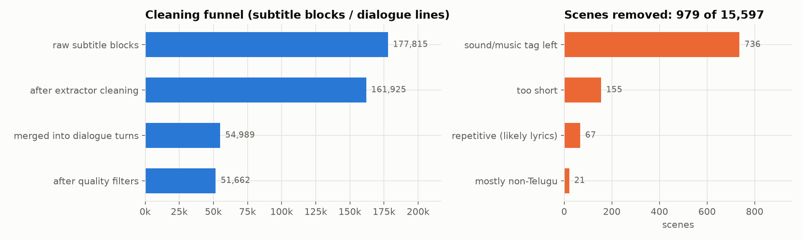
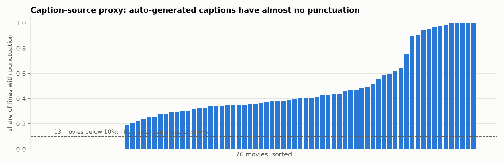
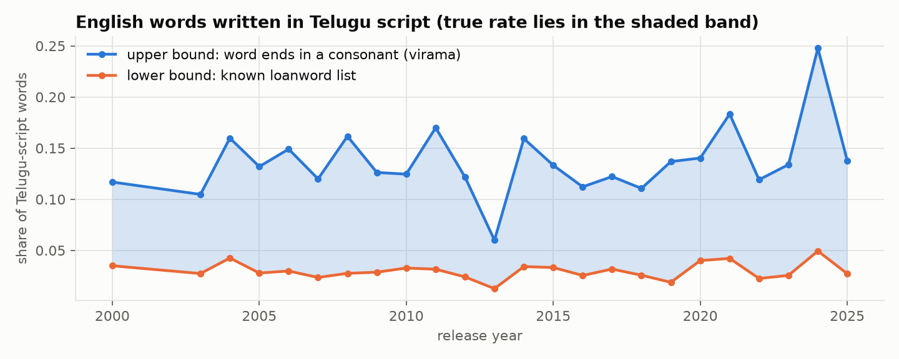
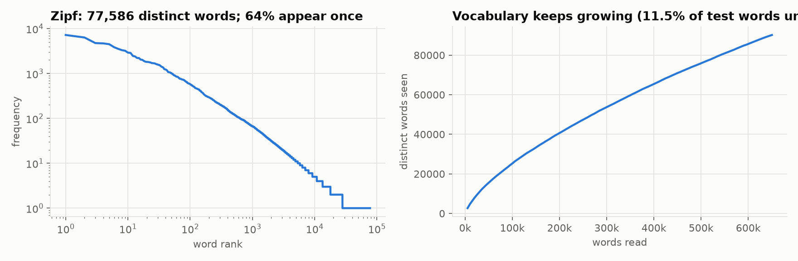

# Data card: Telugu movie dialogue corpus

> For research and education only. The corpus is **not distributed** with this repository; only statistics and plots are.
> Figures come from `stages/s0_corpus_stats.py` and `stages/s0b_data_card.py`.

## Summary

| | |
|---|---|
| Content | Spoken dialogue from 76 Telugu feature films |
| Release years | 2000–2025 |
| Size | 15,597 scenes · 54,989 dialogue turns · ~658k words (Telugu script) |
| After quality filters | 14,618 scenes · 51,662 turns |
| Split | **by movie**: 60 train / 8 validation / 8 test (`data/split_manifest.json`, seed 42) |
| Language | Telugu (colloquial, spoken register) with embedded English words, in Telugu script |
| Source | Telugu subtitle tracks of publicly available YouTube uploads, fetched by `extractor/` |

## How it was built (`extractor/`)

1. **Download subtitles.** For each movie URL, the extractor picks the best available Telugu track. In priority order:
   manual Telugu captions → YouTube's auto-generated Telugu captions (speech recognition) → other tracks machine-translated to Telugu.
2. **Clean.** Remove bracketed sound and music tags (`[సంగీతం]`, `[Music]`), statutory smoking/drinking disclaimers,
   BGM humming lines, song and title cards, and the rolling duplicates typical of auto-captions.
3. **Merge into turns.** Consecutive subtitle blocks are merged into dialogue **turns**.
4. **Group into scenes.** Turns are grouped by timing into **scenes of 2–4 turns**.

### Definitions (important for interpreting every number)

- A **turn** ("line" in the plots) is one or more consecutive subtitle blocks. **It is not guaranteed to be one speaker:**
  **33%** of turns contain more than one sentence, often two speakers merged.
- A **scene** is a time-based group of 2–4 turns. It is **not** a scene in the film-making sense.
- There are **no speaker names**. Subtitles don't carry them.

## Cleaning funnel

177,815 raw subtitle blocks → 161,925 after extractor cleaning → merged into 54,989 turns → **51,662 turns** after quality filters.
The quality filters (`tlm/filters.py`) remove 979 scenes:

| Reason | Scenes |
|---|---|
| leftover sound/music tag | 736 |
| too short (< 20 Telugu characters or < 2 turns) | 155 |
| repetitive text (likely song lyrics) | 67 |
| mostly non-Telugu characters | 21 |

Some lyrics, chants and recognition errors still survive. A manual spot check found song lyrics among supposedly clean scenes.

## Caption quality

The corpus doesn't record which track type each movie used, so caption quality is estimated with a **proxy**: auto-generated
captions carry almost no punctuation.

**13 of 76 movies** have punctuation on fewer than 10% of turns, which suggests auto-generated captions with more recognition
errors. This is a heuristic, not a verified label.

## English inside the Telugu

Contemporary Telugu dialogue mixes in English words written in Telugu script (సార్ *sir*, ఫోన్ *phone*, ప్లీజ్ *please*).
Two estimates bound the true rate:
- **Lower bound (3.0%):** words found in a small known-loanword list.
- **Upper bound (13.4%):** words ending in a consonant (virama ్). Native Telugu words almost always end in a vowel. This
  over-counts, because colloquial clipped forms (రాసావ్) and interjections (రేయ్, ఒరేయ్) also end in a consonant.

## Vocabulary

- 77,586 distinct Telugu-script words in the training movies. **64% appear only once**: Telugu's suffixing creates many rare forms.
- The vocabulary keeps growing with more text: no plateau in sight.
- **11.5% of word occurrences in the test movies never appear in training** (38% of distinct test words).
  A word-level model would fail here, which is why subword tokenization matters.

## Known limitations

- Scripted, dramatized dialogue, not natural conversation.
- Recognition errors in roughly 13 movies; some lyrics remain.
- Turn boundaries don't equal speaker boundaries.
- The v1 keyword-based emotion and dialect tags are present in the raw files but **unreliable** (Stage 0), and they're not used.
- Romanized text in this project is **synthetic**, generated from this corpus (see [ROMANIZATION.md](ROMANIZATION.md)).
