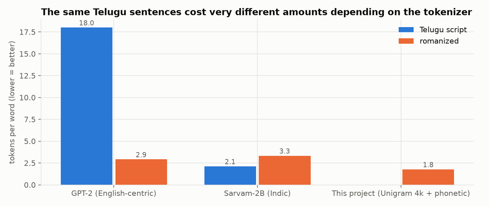
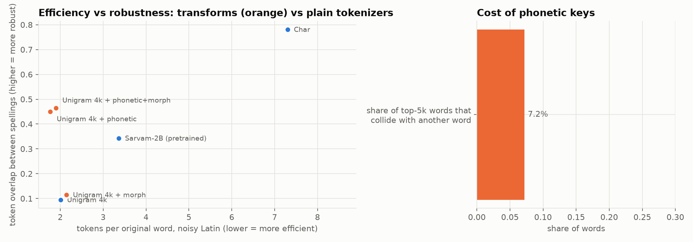
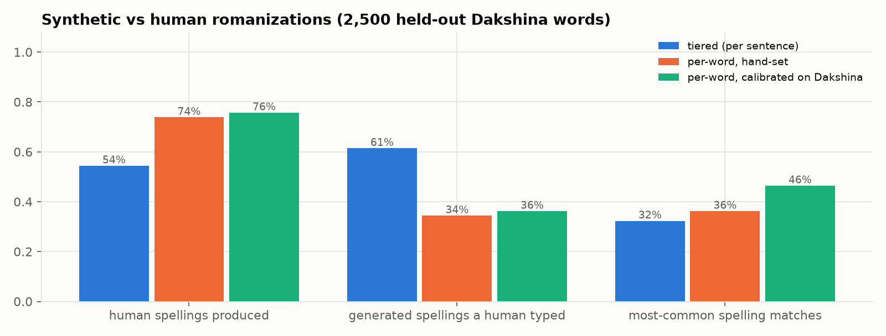
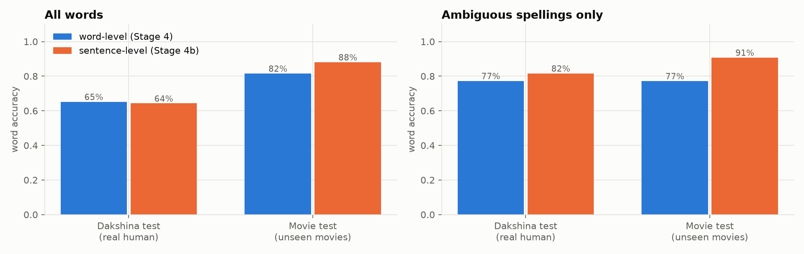
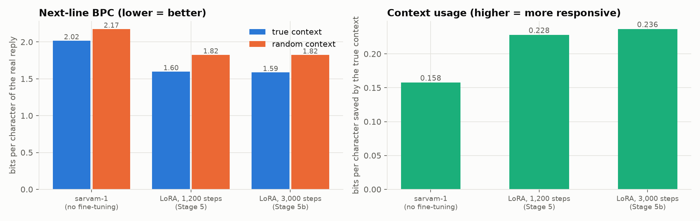
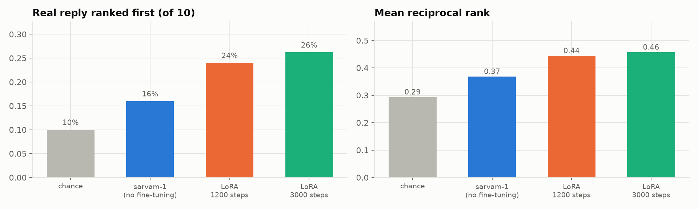
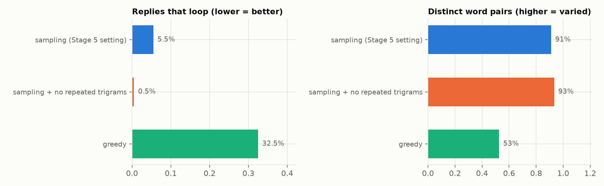

# Results and key ideas, in detail

← Back to the [simple overview](../README.md). This page has the technical explanations and every main chart; the full step-by-step lab notebook is in [STAGES.md](STAGES.md).

---

## The key ideas, explained simply

### What is a "token", and why does it matter for Telugu?
AI models don't read letters or words; they read **tokens**, small chunks of text from a fixed list. `"intha late enduku"` might become
`intha · late · enduku` (3 tokens) or `in · th · a · la · te · end · uku` (7 tokens). **Fewer tokens = faster, cheaper, and the model sees
more context.**

Many popular models were built mainly for English, so they cut Telugu into tiny pieces. This project measured it on the same sentences:

| Tokenizer | Tokens per Telugu word | Tokens per romanized word |
|---|---|---|
| GPT-2 (English-focused) | **18.0** | 2.9 |
| Sarvam-2B (built for Indian scripts) | **2.1** | 3.3 |
| This project's tokenizer | — | **1.8** |

Indian-language models like Sarvam fix the *script* problem (8× better than GPT-2), but they're no better on *romanized* text,
which is how most people actually type.

### Why does spelling make it harder?
If `enti`, `yenti` and `anti` become three unrelated tokens, the model has to learn three times that they mean the same thing. This
project tested several fixes and found that a simple **phonetic key** (treating `th`=`t`, `aa`=`a`, `w`=`v`, doubled letters = single)
makes spellings **4.5× more consistent** while also using fewer tokens. The best overall solution was a dedicated **spelling normalizer**
(step 2 above) that turns any spelling into Telugu script before anything else happens.

### Where did training data come from?
- **Telugu movie dialogue** from YouTube subtitles: 54,656 lines from 76 movies. Real spoken Telugu.
- **Synthetic romanized text:** the movie lines, re-typed in many random but realistic spellings by a "romanizer" whose habits were
  **measured from real people's typing** (Google's Dakshina dataset).
- **Real human romanizations** (Dakshina): Telugu words and sentences typed in English letters by native speakers.

### What does "fine-tuning" (LoRA) mean?
Instead of building a large model from zero (impossible with 1.2M words of data), we take an existing open model (**sarvam-1**) and adjust
it a little. **LoRA** freezes the original 2.5 billion numbers and trains a small add-on of 24 million (about 1%), which was enough to change
the model from answering like a news site to talking like a movie character.

### How do you test replies when there's no single right answer?
For "why are you so late?", *traffic*, *I overslept* and *why do you care?* are all good replies. So no single test is used. Instead there are several:
- Where a correct answer **does** exist (spelling → Telugu script), it's checked directly against human data.
- The reply that **actually** came next in the movie is one good answer: how strongly does the model expect it, and can it pick it out of
  10 options?
- **Behaviour checks:** does the model react to what was said, avoid repeating itself, and understand 4 spellings of the same message the same way?
- **A judge model** (Claude, and Sarvam-M) compares replies. The judge is **tested first** on an easy case (real reply vs a random one).

---

## Results at a glance

| Question | Answer | Details |
|---|---|---|
| How badly do common tokenizers handle Telugu? | GPT-2 needs 18 tokens per Telugu word; Sarvam 2.1; on romanized text, a tokenizer trained on this data needs 1.8 | [Stage 2](STAGES.md#stage-2-which-tokenizer-stagess2_tokenizer_studypy) |
| Can we fake realistic typing? | Yes: the generator produces **76%** of real human spellings, with habits measured from Dakshina | [Stage 1c](STAGES.md#stage-1c-benchmark-against-real-human-spellings-stagess1c_dakshina_benchmarkpy) |
| Can a small model fix spelling? | **68%** of words exactly right on real human typing, **91%** on ambiguous words in movie sentences, **9%** for a dictionary lookup on unseen words | [Stage 4, 4b](STAGES.md#stage-4-a-spelling-normalizer-trained-from-scratch-tlmseq2seqpy-stagess4_preparepy-stagess4_normalizerpy) |
| …and how does Claude do on the same task? | **87%**, still clearly better than our 7.6M-parameter normalizer | [Stage 6](eval/README.md) |
| Does fine-tuning make replies sound like real dialogue? | Yes: real next lines become **21% less surprising** to the model, and it uses context **50% more** | [Stage 5, 5b](STAGES.md#stage-5-a-spoken-style-reply-model-stagess5_preparepy-stagess5_dialogue_lmpy) |
| Can it pick the real reply out of 10? | **26%** of the time (chance: 10%; untuned model: 16%) | [Stage 5c](STAGES.md#stage-5c-evaluating-the-whole-system-automatically-stagess5c_evaluationpy) |
| Does a judge prefer the fine-tuned replies? | Claude (which passed its reliability test 91% of the time) preferred them over the untuned model's in **94%** of pairs | [Stage 6](eval/README.md) |
| Does it still loop or repeat itself? | **0.5%** of replies, with the right generation settings (32% with the naive setting) | [Stage 5b](STAGES.md#stage-5b-better-replies-stagess5b_better_repliespy) |

### In pictures

**1. Tokenizers:** English-focused GPT-2 shreds Telugu script (18 tokens per word). Sarvam fixes the script, but not romanized typing.

**2. Spelling robustness:** a simple phonetic key (orange) makes different spellings share tokens without costing efficiency.

**3. Realistic fake typing:** synthetic spellings checked against real people's spellings from Google's Dakshina dataset.

**4. Fixing spelling:** reading the whole sentence (orange) resolves ambiguous words much better than word by word.

**5. Replies:** fine-tuning makes real dialogue less surprising to the model, and makes it respond more to what was said.

**6. Picking the real reply out of 10** (chance is 10%):

**7. No more loops:** blocking repeated 3-word phrases nearly eliminates repetitive replies.

### What it can do now
| You type | It understands | It replies |
|---|---|---|
| `nuvvu naaku nachchav` | నువ్వు నాకు నచ్చావ్ *(I like you)* | `nannu premisthunnaava?` *(do you love me?)* |
| `repu movie ki veldama?` | రేపు movie కి వెళ్దామా? *(movie tomorrow?)* | `… sare veldaam` *(… ok, let's go)* |
| `sorry ra, traffic lo stuck ayya` | sorry రా, traffic లో stuck అయ్యా | `nuvvu bas ekkuthaava …` *(will you take the bus? …)* |

### Honest limitations
- Replies are often **generic or drift off-topic**; this is a small model with a short training budget.
- The spelling normalizer is still **well behind Claude** (68% vs 87% of words on real typing).
- The romanized training data is **synthetic** (realistic, but generated), and movie dialogue is scripted, not everyday chat.
- English words are detected about 96% of the time; very short chat words (`hi`, `ok`) need a small fixed list.

---

