# Detailed stages: tenglish-lm

← Back to the [project overview](../README.md). This page is the full lab notebook: every stage, every plot and every number,
in the order the project was built. New to the topic? Read the overview and its glossary first.

### How much this costs in practice (measured on this project's test movies)

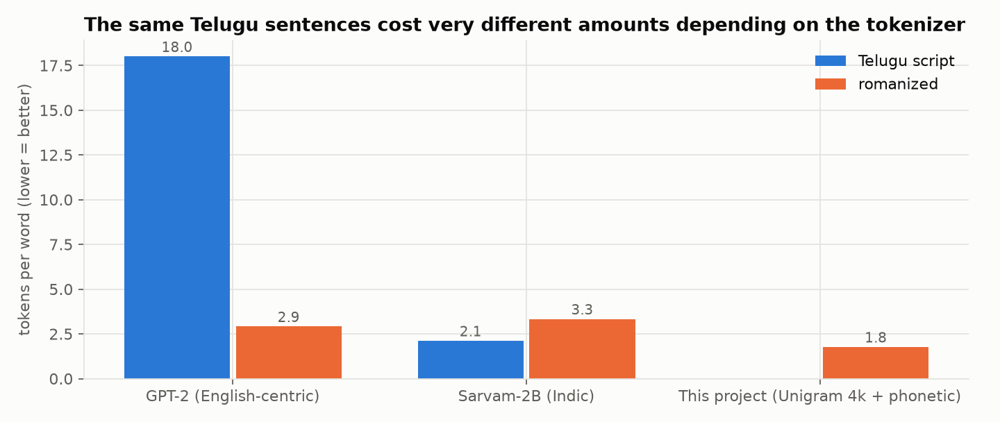

- **GPT-2** (an English-centric tokenizer) needs **~18 tokens for each Telugu-script word**: it is effectively reading raw bytes.
- **Sarvam-2B**, an Indic-language model from Sarvam AI with a tokenizer designed for Indian scripts, needs **~2.1**: about **8× more efficient**.
  This is why Indic-specific models matter.
- **But on romanized Telugu, Sarvam's advantage disappears (3.4 tokens per word, worse than GPT-2's 2.9).** Its tokenizer was built
  for native script, while most people type in Latin letters. Sarvam splits `chesanu` into `c` `hes` `an` `u`.
- A small tokenizer trained on this project's corpus (**Unigram 4k + phonetic key**, Stage 2 below) needs **~1.8**.


### Related work by other labs (other languages and settings)

This problem isn't unique to Telugu. Similar efforts include:

| Work | By | What it does |
|---|---|---|
| **Dakshina dataset** | Google Research | Native-script and romanized text for 12 South Asian languages, including Telugu; a benchmark for transliteration |
| **Aksharantar / IndicXlit** | AI4Bharat (IIT Madras) | A large transliteration dataset and models between Latin and Indic scripts |
| **IndicTrans2** | AI4Bharat | Translation models for 22 scheduled Indian languages |
| **MuRIL** | Google | A multilingual Indian-language model that also trains on transliterated (romanized) text |
| **GLUECoS** | Microsoft Research India | A benchmark for code-switched NLP, including Hindi–English ("Hinglish") |
| **LinCE** | academic collaboration | A benchmark for code-switching across several language pairs |
| **Sarvam-1 / Sarvam-2B** | Sarvam AI | Small Indic-focused language models with Indic-optimized tokenizers |
| **Arabizi research** | various | Arabic written in Latin letters with numbers (`3`, `7`): the same "no spelling standard" problem in another language |

This project differs in focus: **spoken, contemporary, romanized Telugu**, with a deliberately **small** model, built stage by stage for learning.

---


## Stages and results (detailed lab notebook)

Every stage is one script in `stages/`, and each writes its plots to `docs/plots/` and its numbers to `docs/results/`.

### Stage 0: understand the data (`stages/s0_corpus_stats.py`)

76 movies, 15,597 scenes, **54,656 dialogue lines, 658k words**. The median line is 13 words: short, spoken utterances.

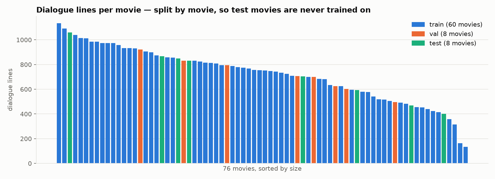

The data is **split by movie** (60 train / 8 validation / 8 test). Every line from a test movie is unseen during training, so
scores measure generalization rather than memorization.

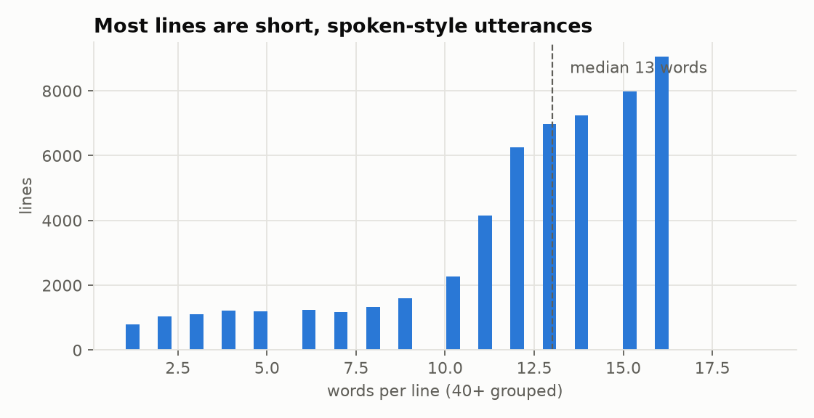 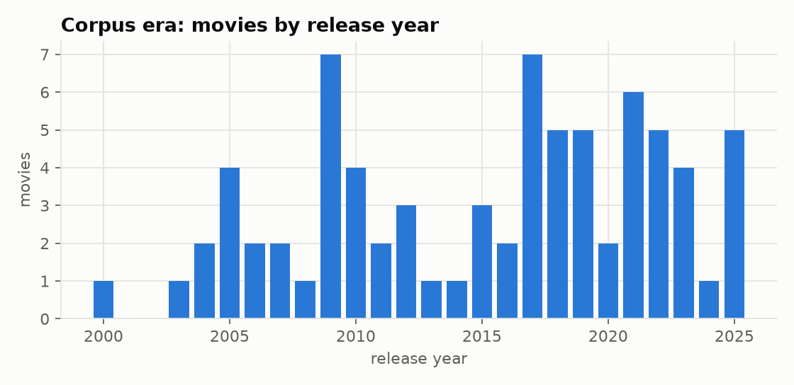

**Finding: automatic keyword labels can't be trusted.** An earlier version tagged dialect by keyword matching. 87% of scenes fell
back to "standard", and **57% of "Rayalaseema" tags were triggered by violence words** (knife, blood) rather than by how anyone speaks.
Those labels are not used.

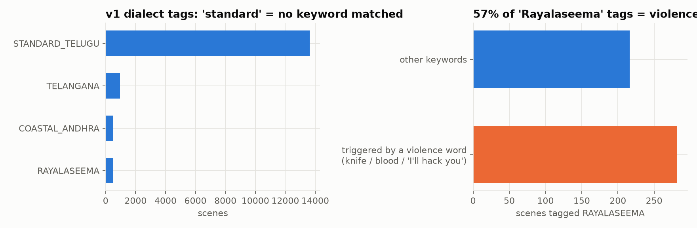

### Stage 0b: data card (`stages/s0b_data_card.py`, full details in [docs/DATA_CARD.md](DATA_CARD.md))

What the corpus actually is, and what to keep in mind when reading every later number:

- **Cleaning funnel:** 177,815 raw subtitle blocks → 161,925 after cleaning → merged into 54,989 dialogue turns →
  **51,662 turns** after quality filters (979 scenes removed, mostly leftover sound/music tags).
- **A "line" is a dialogue turn, not one speaker.** 33% of turns contain more than one sentence.
- **Caption quality:** 13 of 76 movies have almost no punctuation, which points to auto-generated (speech-recognition) captions.
- **English inside Telugu:** between **3% and 13%** of Telugu-script words are English loanwords (సార్, ఫోన్, ప్లీజ్).
- **Vocabulary:** 64% of words appear only once, and **11.5% of words in the test movies never occur in training**.
  Word-level vocabularies can't work here.

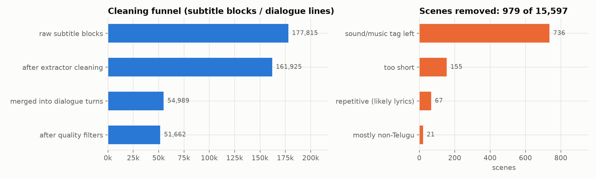
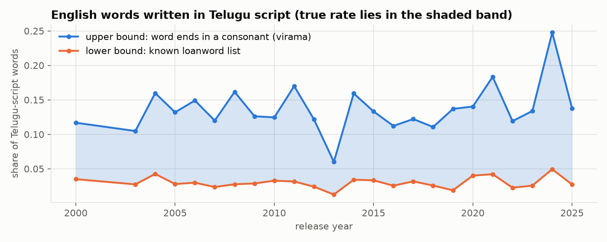
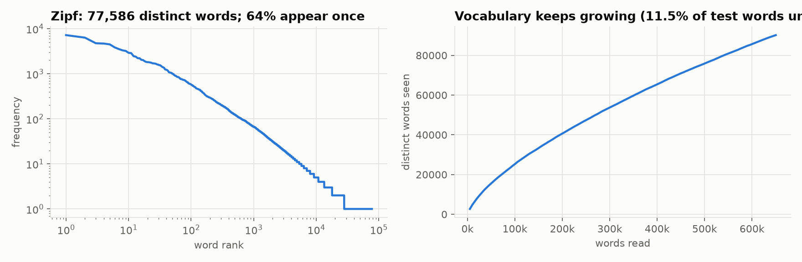

### Stage 1: simulate how people type (`tlm/romanizer.py`, `stages/s1_romanizer.py`)

Real romanized data is scarce, so the project generates it. The romanizer converts Telugu script to Latin letters by choosing
**one realistic spelling per sound, independently for each word**, from observed alternatives (`aa`/`a`, `th`/`t`, `v`/`w`, `e`/`ye`…).
It also gives each sentence a "typing habit", from careful (`raasaanu`) to lazy (`rasa`). English loanwords stay in English.

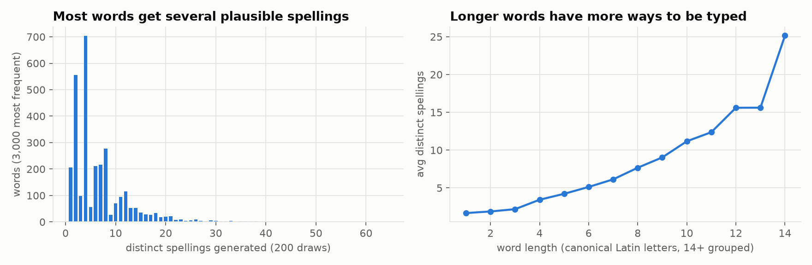

| Telugu | canonical | generated spellings |
|---|---|---|
| కాదు | `kaadu` | `kaadu`, `kaadhu`, `kadu`, `kadhu` |
| నువ్వు | `nuvvu` | `nuvvu`, `nuwwu`, `nuvu`, `nuwu` |
| లేదు | `ledu` | `ledu`, `ledhu`, `leedu` |

Frequent words get **~6.5 different spellings** on average, including chat shorthand (`nen`, `nuvv`, `enty`, `chesa`).
The complete rules and probabilities are in [docs/ROMANIZATION.md](ROMANIZATION.md); more examples in
[docs/results/s1_examples.md](results/s1_examples.md).

### Stage 1b: which way of generating synthetic text? (`tlm/tiers.py`, `stages/s1b_generator_comparison.py`)

There's more than one way to fake human typing. Three strategies were compared:

| Strategy | How it varies | Assumption |
|---|---|---|
| **Tiered** (a design proposed by Gemini) | one fixed style **per sentence**: P1 standard, P2 minimal, P4 lazy | each person types consistently |
| **Per-word** (this project) | every **word** gets its own random spelling, plus a per-sentence habit | people aren't consistent, even within a sentence |
| **Hybrid** | a tier per sentence, with 30% of words re-sampled per word | somewhere in between |

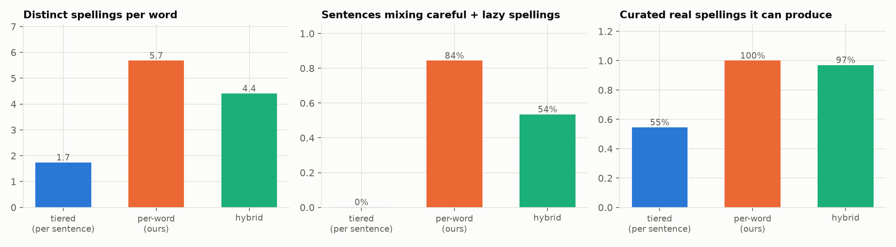

- **Diversity:** the tiered approach gives only ~1.7 spellings per word; per-word gives ~5.7.
- **Mixing:** real messages often mix careful and lazy spellings (`intha late ayyindi, nuvu chepu`). Tiered sentences never do (0%);
  per-word sentences do 84% of the time.
- **Curated real spellings:** against a small hand-curated list of common real spellings ([tlm/reference_spellings.py](../tlm/reference_spellings.py)),
  the tiered approach produces 55%. Per-word produced 86% before calibration and **100% after shorthand rules were added**.
  *Caution:* the rules were calibrated against this same list, so the post-calibration number isn't an independent test.

**The more useful test: does training on one generator prepare a tokenizer for another generator's spellings?**

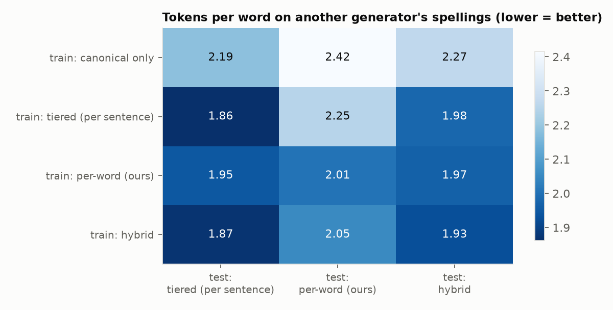

A tokenizer trained on **tiered** text handles tiered text well (1.86 tokens per word) but struggles with per-word spellings (2.18).
A tokenizer trained on **per-word** text is nearly equally good on all three (1.95–1.99). Training only on canonical spellings is worst everywhere.
**Per-word generation is kept as the default**, because it prepares the model for spelling styles it hasn't seen. The hybrid is a close second.

### Stage 1c: benchmark against real human spellings (`stages/s1c_dakshina_benchmark.py`)

Synthetic text is only useful if it resembles real typing. Google's **Dakshina dataset** includes ~30k Telugu words, each romanized
by several native speakers, with how many typed each spelling (అంకిత → `ankita` ×2, `ankitha` ×2, `amkita` ×1). This is real
human spelling variation, and it was used in two ways:

**1. Measure real habits (from Dakshina's 25k *train* words) and replace the hand-set guesses with them.**

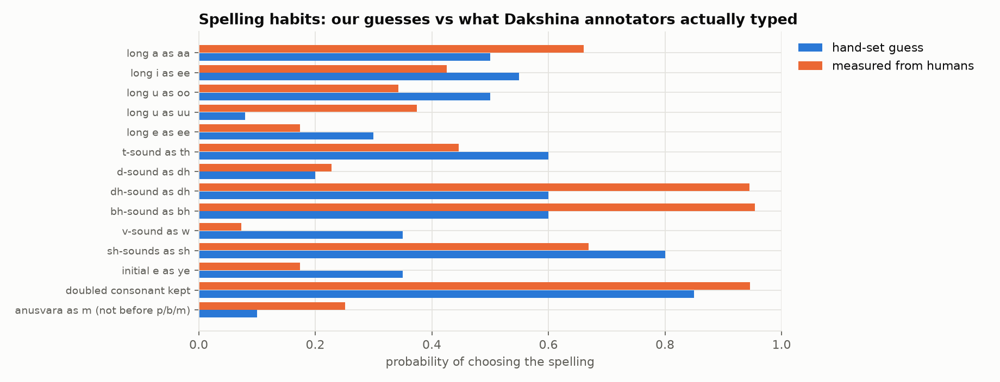

Several guesses were clearly off. People type long ū as `uu` far more often than expected (`chuudu`, 37%), rarely use `w`
for వ (7%), and keep `dh` and `bh` almost always (~95%). The romanizer now uses these measured probabilities by default
(`tlm/romanizer_calibrated.json`; set `TLM_HANDSET=1` for the original guesses).

**2. Score the generators on 2,500 *held-out test* words.**

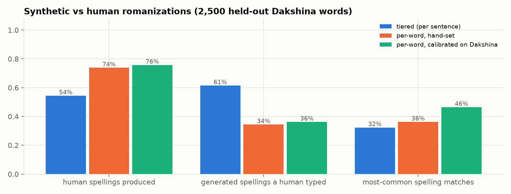

| Generator | human spellings it produces | its spellings a human typed | most-common spelling matches |
|---|---|---|---|
| tiered (per sentence) | 54% | **61%** | 32% |
| per-word, hand-set | 74% | 34% | 36% |
| **per-word, calibrated** | **76%** | 36% | **46%** |

- Calibration mostly helps the generator get the **most common** spelling right (36% → 46%).
- The per-word generator covers far more of the human variation than tiers, but it also invents spellings no annotator typed.
  Part of that is measurement (only 2–3 annotators per word), and part is real over-generation, including chat shorthand
  that careful annotators don't use.
- **Caveat:** Dakshina's words come from **Wikipedia** and cover only **58% of the movie corpus's 5,000 most frequent words**.
  It validates spelling *rules*, not colloquial vocabulary or chat shorthand.


### Stage 2: which tokenizer? (`stages/s2_tokenizer_study.py`)

Tokenizers are trained on the training movies and scored on the test movies, on two measures:
- **Fertility:** tokens per word. Lower means more efficient.
- **Spelling consistency:** take 8 spellings of the same word and measure how many tokens they share. Higher means the
  model can more easily see that `enti` and `yenti` are the same word.

Three tokenizer types:
- **BPE:** repeatedly merges the most frequent pair of symbols. It's used by GPT models.
- **Unigram:** keeps a vocabulary of pieces with probabilities, and can *sample* different ways of splitting a word during training.
- **Character:** one token per letter.

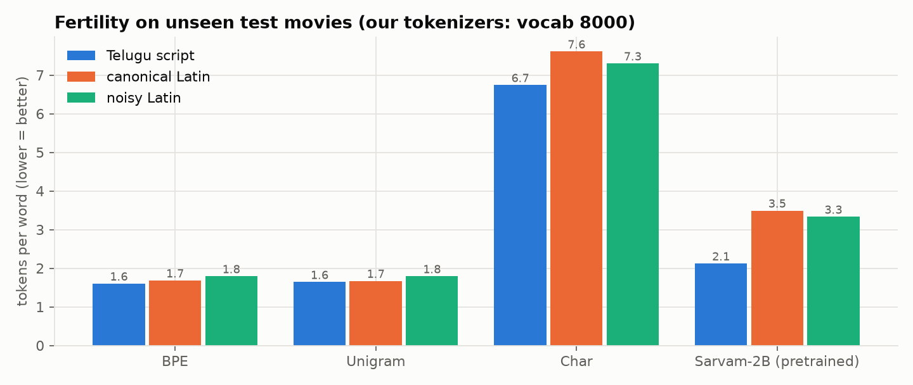

**Finding 1: a corpus-trained tokenizer is about 2× more efficient than Sarvam's on romanized text** (1.8 vs. 3.4 tokens per word).

**Finding 2: efficiency and spelling robustness pull in opposite directions.** With a large vocabulary, each spelling becomes its own
whole-word token (`enti`, `yenti` and `anti` share nothing). Smaller vocabularies share more pieces but need more tokens.
Characters are the most robust (0.78 overlap), but cost ~7 tokens per word. ([segmentation examples](results/s2_segmentations.md))

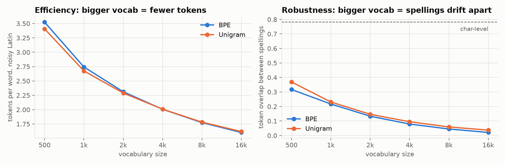

**Finding 3: a phonetic key gets around the trade-off.** Before tokenizing, spelling choices that don't change meaning are collapsed
(`th→t`, `dh→d`, `aa→a`, `w→v`, doubled letters → single, initial `ye→e`). Then `yenti`/`enti` and `intha`/`inta` become identical.

| Method (Unigram, 4k vocab) | tokens per word ↓ | spelling consistency ↑ |
|---|---|---|
| plain | 2.01 | 0.10 |
| + morphology split (`intlo → int ##lo`) | 2.15 | 0.12 |
| **+ phonetic key** | **1.77** | **0.45** |
| + phonetic key + morphology | 1.90 | 0.46 |
| Character-level (reference) | 7.30 | 0.78 |
| Sarvam-2B pretrained (reference) | 3.36 | 0.34 |

The phonetic key makes text **~4.5× more spelling-robust and more efficient at the same time**. Morphology splitting alone barely helps.

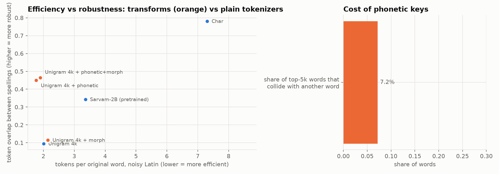

**The cost:** **7.2%** of common words collapse onto another real word: `nee`/`ni` ("you" vs "your"), `oka`/`okka`,
`vaadu`/`vaddu` ("he" vs "don't"). The model then has to tell them apart from context. Full list: [docs/results/s2_phonetic_collisions.md](results/s2_phonetic_collisions.md)

**Current choice:** Unigram (4k) with the phonetic key for input. Stage 3 tests whether this actually helps a model learn.


### Stage 3: tiny language models from scratch: does the tokenizer matter? (`tlm/tinygpt.py`, `stages/s3_tiny_lms.py`)

Tokenizer statistics only predict what *should* help. Stage 3 checks what actually helps a model learn: the **same tiny GPT**
(4 layers, 256-dim, ~3–4M parameters, written from scratch in `tlm/tinygpt.py`), trained on the **same noisy romanized text**
(train movies, ~11M characters), for the **same budget** (2 passes over the text), with only the tokenizer changing.
It ran on a free-tier-sized Colab T4, in 1.5–4.5 minutes per model.

**How models are compared:** loss per token isn't comparable across tokenizers, because a token can be one letter or a whole word.
The fair measure is **bits per character (BPC)**: how many bits the model needs, on average, to predict each character of the *original*
test text (8 unseen movies). Lower is better. **Spelling spread** feeds the same test sentence in 4 spellings and measures how much the
model's BPC changes between the best and worst spelling. Lower means spelling throws the model less.

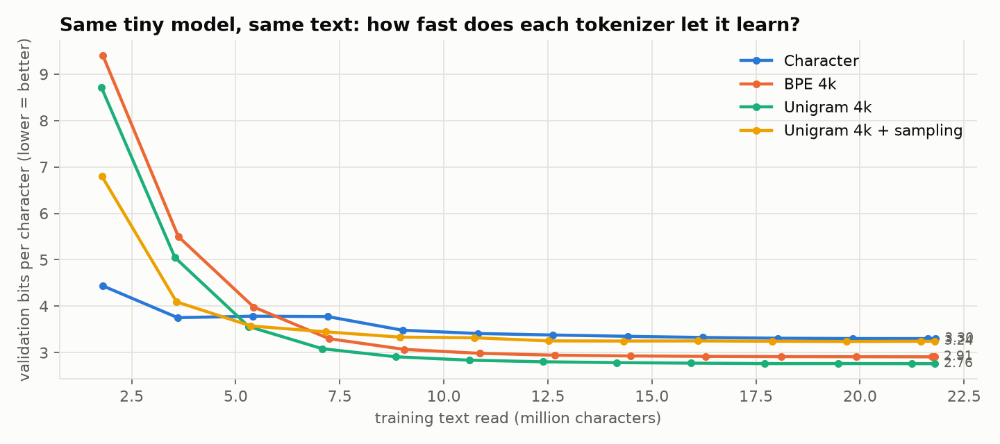
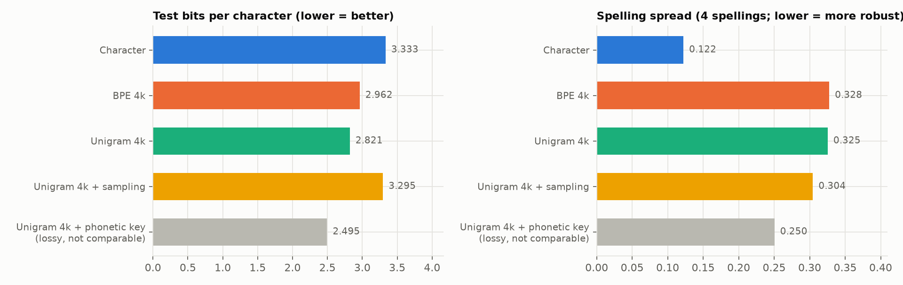

| Tokenizer | test BPC ↓ | spelling spread ↓ | training steps |
|---|---|---|---|
| Character | 3.33 | **0.12** | 1,331 |
| BPE 4k | 2.96 | 0.33 | 361 |
| **Unigram 4k** | **2.82** | 0.33 | 357 |
| Unigram 4k + subword sampling | 3.30 | 0.30 | 719 |
| Unigram 4k + phonetic key *(lossy, see below)* | 2.49 | 0.25 | 314 |

**Findings**

1. **Unigram beats BPE, and both beat characters**, given the same model and the same text: 2.82 vs 2.96 vs 3.33 BPC. Subword tokens let a
   small model see more text per step, and Unigram's segmentation fits Telugu's syllable structure slightly better than BPE's greedy merges.
2. **Characters are by far the most spelling-robust** (spread 0.12 vs ~0.33): `enti` and `yenti` differ by a single token. But the
   model learns the *language* worse.
3. **Subword sampling didn't help at this scale.** It improved robustness only slightly and cost about 0.5 BPC. Sampling usually needs
   longer training to pay off. (A first version of this run accidentally gave the sampling model only half the text; it was found from
   the learning curve, fixed and rerun.)
4. **Part of what the model "can't learn" is pure spelling randomness.** The romanizer picks spellings at random (`intha` vs `inta`), and no
   model can predict a coin flip, so noisy romanized text has a built-in floor. The phonetic key removes that randomness before the model sees
   it, which is why its BPC is much lower (2.49). Because it changes the text, the number isn't directly comparable. But it points to the
   design decision for the next stages: **let a small normalizer deal with spelling, so the language model can spend its capacity on Telugu
   itself.**

**Caveats:** these are tiny models with a short budget; the curves are still slowly improving at the end. The ranking at this scale may not
hold for much larger models. Equal *text* doesn't mean equal *compute*: the character model needs ~3.7× more steps.


### Stage 4: a spelling normalizer trained from scratch (`tlm/seq2seq.py`, `stages/s4_prepare.py`, `stages/s4_normalizer.py`)

Stage 3 showed that random spelling variation wastes a language model's capacity. Stage 4 builds the fix: a small model that turns
**any romanized spelling into Telugu script** (`yenti` / `enti` → ఏంటి). Once a word is in Telugu script, its canonical romanization
is a fixed rule, so this one model is also the core of the **converter**.

**Model:** a character-level **encoder–decoder transformer** (3 + 3 layers, 256-dim, ~5M parameters), trained from scratch. The encoder
reads the Latin letters; the decoder writes Telugu characters one at a time while attending to the input (cross-attention).

**Data:** the same model is trained on three data mixes, for the same number of steps:
- **Dakshina only:** 58k real human spellings of formal (Wikipedia) words.
- **Synthetic only:** 247k spellings of the 75k words in the training movies, from the calibrated romanizer.
- **Both.**

**Tests:**
- Dakshina's held-out words (real people, words never seen in training).
- Words from the **8 unseen movies**: "seen" words also occur in the training movies; "unseen" words never do.

**Baseline:** a lookup table (phonetic key → most frequent Telugu word). It can only handle words it has already seen.

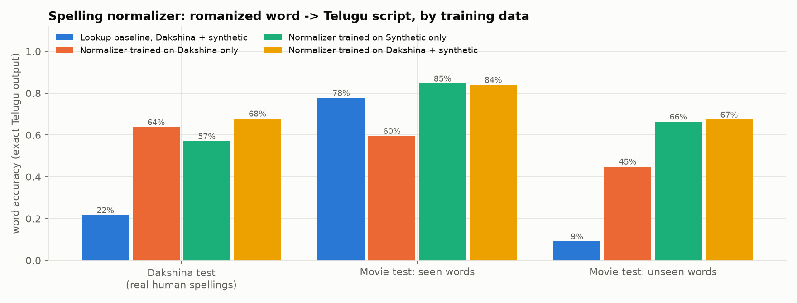

| Method | Dakshina test (real spellings) | Movie words, seen | Movie words, **unseen** |
|---|---|---|---|
| Lookup baseline (both datasets) | 22% | 78% | 9% |
| Normalizer: Dakshina only | 64% | 60% | 45% |
| Normalizer: synthetic only | 57% | **85%** | 66% |
| **Normalizer: Dakshina + synthetic** | **68%** | 84% | **67%** |

Character error rate for the best model: **9%** on Dakshina, **5%** on seen and **8%** on unseen movie words.

**Findings**

1. **The model generalizes; the lookup can't.** On movie words never seen in training, the lookup gets 9% and the normalizer 67%.
   It has learned how sounds map to letters, not just a list of words.
2. **Each data source covers the other's blind spot.** Real human spellings (Dakshina) teach how people actually type; the synthetic movie
   data teaches spoken vocabulary. Combining them is best on real spellings (68%) and on unseen words (67%).
3. **Real-spelling accuracy is the honest number**, and 68% exact-match on real human spellings leaves clear room to improve. Many
   errors are a single character (CER 9%), often the long/short vowel ambiguity that typing hides (`chesanu` → చేశను instead of చేసాను).

**What it gets right and wrong** ([more examples](results/s4_examples.md)):

| typed | output | |
|---|---|---|
| `yenti`, `enti` | ఏంటి | ✅ both spellings map to the same word |
| `intha`, `inta` | ఇంత | ✅ |
| `nuvvu`, `nuwu` | నువ్వు | ✅ even with a dropped double letter |
| `chuudu`, `choodu` | చూడు | ✅ |
| `vellipothunna` | వెళ్ళిపోతున్నా | ✅ a long colloquial verb form |
| `anti` | అంటి | ⚠️ plausible, but in chat it usually means ఏంటి. That needs **sentence context** |
| `chesanu` | చేశను | ❌ vowel length lost, and శ vs స is ambiguous |
| `late`, `exam` | లాటే, ఎక్స్కం | ❌ **English words** are read as Telugu sounds; they need an English-aware path |

**Next steps for the normalizer:** sentence-level context (to resolve `anti`, `nee`/`ni`), handling English words (detect them and keep or
transliterate them as English), and beam search instead of greedy decoding. The trained model (~22 MB) isn't committed to git.


### Stage 4b: context and English words (`tlm/langid.py`, `stages/s4b_*.py`)

The word-level normalizer has two blind spots: it can't use **context** (`anti` → అంటి, when in chat it usually means ఏంటి), and it forces
**English words** into Telugu sounds (`late` → లాటే). Stage 4b adds two pieces:

**1. English detection (token language ID).** A character n-gram Naive Bayes classifier learns which letter patterns are typical of English
(`-tion`, `ck`, `ght`) versus romanized Telugu (`aa`, `-ndi`, words ending in vowels). It's trained on an English wordlist and on romanized
words from the training movies.

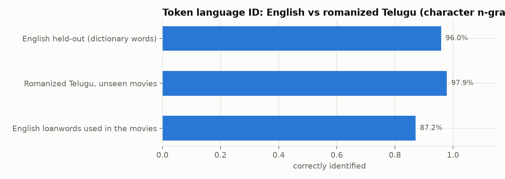

It correctly identifies 96% of held-out English words and 98% of romanized Telugu words from unseen movies. Only **1% of Telugu words in
running text** get wrongly flagged as English, and many of those are English words spelled phonetically (`kembrij`, `french`). It misses
some very short chat words (`hi`, `ok`, `thanks`), which a small override list covers.

**2. A sentence-level normalizer.** The same kind of character model as Stage 4 (4 + 4 layers, ~7M parameters), but it reads and writes
**whole sentences**. Detected English words become a placeholder (`@`) and are put back unchanged afterwards:

```
"bro exam ela rasav, results eppudu?"
  -> English detected:   "@ @ ela rasav, @ eppudu?"
  -> sentence model:     "@ @ ఎలా రాసావ్, @ ఎప్పుడు?"
  -> English restored:   "bro exam ఎలా రాసావ్, results ఎప్పుడు?"
```

It's trained on 136k sentence pairs: movie turns with synthetic spellings, plus Dakshina's 5k real human-romanized dev sentences.
It's compared with the Stage 4 word model on Dakshina's real test sentences and on sentences from the unseen movies:

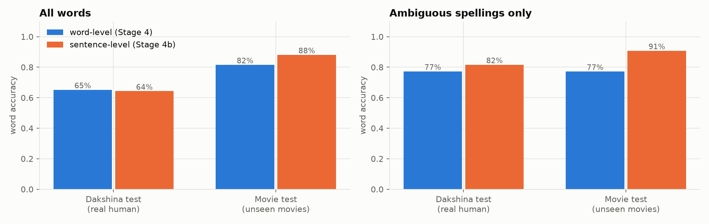

| Test set | Model | word accuracy | **ambiguous spellings** | character error rate |
|---|---|---|---|---|
| Movie sentences (unseen movies) | word-level | 82% | 77% | 4.3% |
| | **sentence-level** | **88%** | **91%** | **2.9%** |
| Dakshina sentences (real human, formal) | word-level | **65%** | 77% | **7.5%** |
| | sentence-level | 64% | **82%** | 7.9% |

"Ambiguous spellings" are words whose romanized form maps to two or more different Telugu words in the training data (`nee`/`ni`, `anti`).

**Findings**

1. **Context fixes ambiguity.** On ambiguous spellings, the sentence model is +14 points better on movie sentences and +4 on real Dakshina sentences.
2. **On spoken movie text, the sentence model wins overall** (88% vs 82% of words, character error rate down by a third).
3. **On formal real text, it's no better overall.** Its training data is mostly spoken movie dialogue (only 5k formal sentences), so on
   formal Wikipedia sentences it gains on ambiguous words but loses slightly elsewhere. More real romanized sentences would help.
   This is a data limitation, not a modeling one.

**Full pipeline on code-mixed chat** (handwritten examples, [all here](results/s4b_examples.md)):

| typed | output |
|---|---|
| `anti ra inta lete?` | ఏంటి రా ఇంత lete? |
| `ni peru enti?` | నీ పేరు ఏంటి? |
| `bro exam ela rasav, results eppudu?` | bro exam ఎలా రాసావ్, results ఎప్పుడు? |
| `nee phone number ivvu` | నీ phone number ఇవ్వు |
| `sorry ra, traffic lo stuck ayya` | sorry రా, traffic లో stuck అయ్యా |
| `nenu office ki vellanu, meeting undi` | నేను office కి వెళ్ళాను, మీటింగ్ ఉంది |

What this shows:
- `anti` is now correctly read as ఏంటి from context. The word-level model wrote అంటి.
- English words survive untouched.
- **Remaining errors:** the misspelled `lete` was taken for English. `meeting` wasn't detected as English, so it was transliterated
  (మీటింగ్), which is acceptable Telugu but inconsistent.


### Stage 5: a spoken-style reply model (`stages/s5_prepare.py`, `stages/s5_dialogue_lm.py`)

With spelling handled by the normalizer, Stage 5 trains the part that **talks**: given the previous one or two lines of dialogue (in Telugu
script), produce the next line in spoken, movie-style Telugu. The data is 29k context → next-line pairs from the training movies, tested on
1,500 pairs from the 8 unseen movies.

**Choosing a base model.** Tokenizer cost on Telugu decides a lot for a small model:

| Candidate | Access | Tokens per Telugu word |
|---|---|---|
| **sarvam-1** (2B, Sarvam AI) | open | **2.1** |
| Qwen2.5-0.5B | open | 9.8 |
| GPT-2 | open | 17.8 |
| Gemma-3-1B | gated | — |

**Three models**, scored with the same metric: bits per character of the **real** next line given its context (lower means the model
expected what was actually said):

1. **sarvam-1 as-is**, no fine-tuning
2. **sarvam-1 + LoRA**: about 24M trainable parameters (0.9% of the model), 1,200 steps on the dialogue pairs, with the loss computed on the
   reply only; about 70 minutes on a Colab L4
3. **A tiny GPT trained from scratch** (5M parameters, this project's Telugu Unigram tokenizer), as a small-model reference

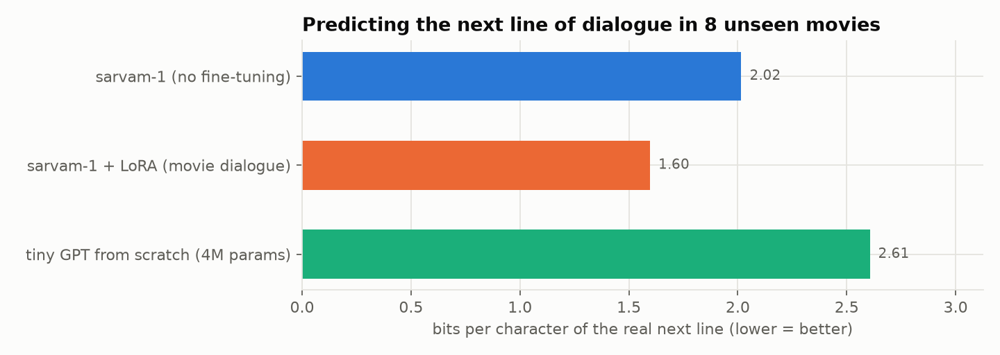

| Model | bits per character ↓ |
|---|---|
| sarvam-1, no fine-tuning | 2.02 |
| **sarvam-1 + LoRA on movie dialogue** | **1.60** |
| tiny GPT from scratch (5M) | 2.61 |

**Findings**

1. **Fine-tuning on movie dialogue makes the real next lines 21% less surprising** to the model (2.02 → 1.60 bits per character).
2. **It changes the register.** Before fine-tuning, sarvam-1 often answers like a news site or an essay, sometimes even opening with a date
   ("2013 జూలై 12 - …"), which is its pretraining data showing through. After fine-tuning, the replies are spoken dialogue.
3. **Pretraining matters.** The 5M from-scratch model is far behind (2.61), even though it uses a more efficient tokenizer. On 29k pairs,
   general Telugu knowledge can't be learned from scratch.

**Sample replies** ([all side-by-side examples](results/s5_examples.md)):

| last line | sarvam-1 as-is | sarvam-1 + LoRA |
|---|---|---|
| ఏంట్రా ఇంత లేట్ అయ్యింది? *(why are you so late?)* | 2013 జూలై 12 - ఏంట్రా ఎందుకు ఆలస్యమైంది? | నేను రాలేదు సార్. *(I didn't come, sir.)* |
| అమ్మా, నేను సిటీకి వెళ్ళిపోతున్నాను. *(Mom, I'm leaving for the city.)* | 2013 జూలై 16 - మమ్మీకి ఒక బిడ్డ పుట్టబోతోంది! | నేను తిరిగి వచ్చినప్పుడు, మీరు మరియు మామయ్య మిమ్మల్ని తీసుకోవడానికి వస్తారు. |

**End to end:** romanized input → Stage 4 normalizer → reply → canonical romanization:

| typed | reply (romanized) |
|---|---|
| `nuvvu naaku nachchav` *(I like you)* | `nenu neeku nachchaana …` *(you like me? …)* |
| `ekkadiki veltunnav ra?` *(where are you going?)* | `nenu velladam ledu. meeru nannu vellamani adigithe, nenu meetho velthaanu.` *(I'm not going. If you ask me to go, I'll go with you.)* |
| `amma, nenu city ki vellipothunna` | `nenu sitee ki velthaanu amma. nuvvu sitee ki vellalevu please please` |

**Honest limitations**

- **Coherence is weak.** Replies are often generic ("నేను మీకు సహాయం చేశాను", *I helped you*), drift off-topic, or loop
  (a devotional song context produced శివుడు repeated many times).
  This is a small budget: 2B parameters, 0.66 of an epoch, short context.
- **The demo uses the Stage 4 word normalizer** (the Stage 4b sentence model wasn't saved), so English words still get Telugu-ized there:
  `late` → లాటే. Wiring in the Stage 4b pipeline fixes this.
- **Lower bits per character means the model better predicts real dialogue. It doesn't guarantee good replies.** A human or
  model-graded evaluation of reply quality is still missing.
- **Engineering notes:** two out-of-memory crashes on the 22 GB L4 were fixed with gradient checkpointing and gradient accumulation
  (4 × 4 micro-batches).


### Stage 5b: better replies (`stages/s5b_better_replies.py`)

Stage 5's replies were spoken-style but often looped or drifted. Stage 5b tackles four things, on an A100 (about 1.5 hours including the
Stage 4b retrain):

**1. More training:** the Stage 5 adapter was trained for 1,800 more steps (3,000 in total, ~1.6 epochs).

**2. A context-usage test.** A reply model should respond to *what was said*. The real reply is scored twice: once after its **true**
previous line, and once after a **random** line from another scene. The gap in bits per character measures how much the model uses the context.

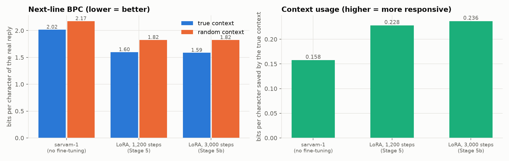

| Model | real reply, true context | real reply, random context | context gain ↑ |
|---|---|---|---|
| sarvam-1, no fine-tuning | 2.02 | 2.17 | 0.16 |
| LoRA, 1,200 steps | 1.60 | 1.82 | 0.23 |
| **LoRA, 3,000 steps** | **1.59** | 1.82 | **0.24** |

Fine-tuning on dialogue makes the model use context about **50% more**: it learns to *respond*, not just to produce movie-style text.
Training beyond 1,200 steps gives only a small extra gain, so this data is close to exhausted at this model size.

**3. Decoding: how text is generated from the model.** The same model and the same 200 unseen contexts were run with three settings:

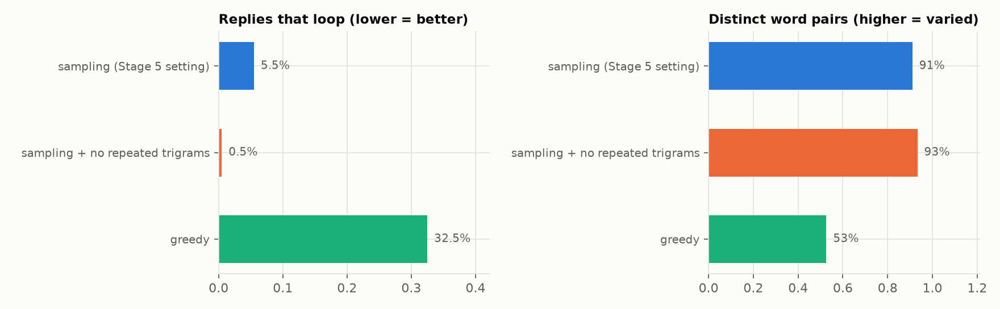

| Setting | replies that loop ↓ | distinct word pairs ↑ |
|---|---|---|
| sampling, temperature 0.8 (Stage 5) | 5.5% | 91% |
| **sampling + no repeated 3-word phrases** | **0.5%** | **93%** |
| greedy (always the most likely word) | 32.5% | 53% |

Blocking repeated 3-word phrases nearly eliminates loops. **Greedy decoding** loops in a third of replies; it's the classic failure
for small models ([examples](results/s5b_examples.md): `ఓకే ఓకే ఓకే …`). It's now the default.

**4. The full pipeline:** English detection → sentence normalizer (Stage 4b) → reply model → canonical romanization:

| typed | understood as | reply (romanized) |
|---|---|---|
| `nuvvu naaku nachchav` | నువ్వు నాకు నచ్చావ్ | `nannu premisthunnaava?` *(do you love me?)* |
| `repu movie ki veldama?` | రేపు movie కి వెళ్దామా? | `… sare veldaam` *(… ok, let's go)* |
| `sorry ra, traffic lo stuck ayya` | sorry రా, traffic లో stuck అయ్యా | `nuvvu bas ekkuthaava nenu bas ekkestha veldaam` *(will you take the bus? I'll take it, let's go)* |
| `enti ra intha late ayyindi?` | ఏంటి రా ఇంత late అయ్యింది? | `eeroju nenu late ayana …` *(even though I'm late today …)* |
| `bro exam ela rasav, results eppudu?` | bro exam ఎలా రాసావ్, results ఎప్పుడు? | `eeroju udayam. randi. hello, mee peru emiti?` ❌ *(off-topic)* |

English words now pass through unchanged (`late`, `movie`, `traffic`), which fixes the Stage 5 demo. More replies fit the message, but
some still drift off-topic.

### Stage 5c: evaluating the whole system automatically (`stages/s5c_evaluation.py`)

Dialogue is hard to grade: for "why are you so late?", *traffic*, *I overslept* and *why do you care?* are all good replies, and only one of them
is in the movie. So, besides the component tests above, two automatic tests were added that don't need anyone to label data.

**Pick the right reply.** For 500 unseen-movie contexts, the real reply is hidden among 9 replies from other scenes. The model scores all 10
and should rank the real one first. Chance is 10%.

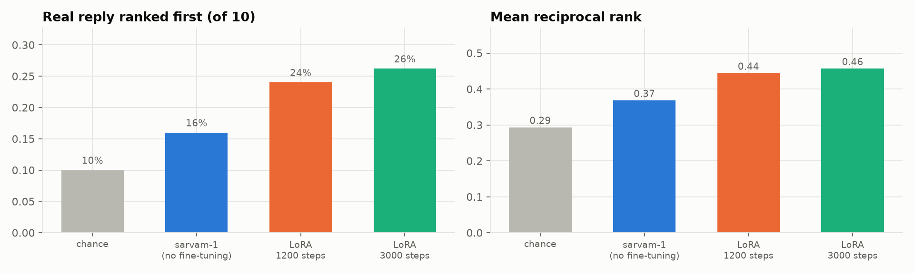

| Model | ranked first | mean reciprocal rank |
|---|---|---|
| chance | 10% | 0.29 |
| sarvam-1, no fine-tuning | 16% | 0.37 |
| LoRA, 1,200 steps | 24% | 0.44 |
| **LoRA, 3,000 steps** | **26%** | **0.46** |

The fine-tuned model picks the true reply **2.6× more often than chance**, and 1.6× more often than the untuned model.

**Same message, four spellings.** 300 messages from unseen movies, each romanized 4 different ways, are passed through the normalizer.

| Measure | Result |
|---|---|
| Character difference between the 4 understood versions | **3.2%** |
| Character error versus the real sentence | 6.1% |
| All 4 versions *exactly* identical | 22% |
| Understood *exactly* right (whole sentence) | 22% |

At character level, spelling barely matters (3% difference). But whole sentences rarely come out *perfectly* identical: one wrong vowel
anywhere in a 10-word sentence counts as a miss. This is the clearest remaining weakness, and the target for a stronger normalizer.

**Efficiency**

| | |
|---|---|
| Reply model | sarvam-1, 2.5B parameters (base) + a 24M-parameter adapter (48 MB in bf16) |
| Normalizer | 7.6M parameters |
| Speed | ~2 seconds per 30-token reply on an A100 with the adapter unmerged. Merging the adapter and batching would be much faster. |

**Not yet done:** a judgment of reply *quality* (naturalness, relevance, register) by humans or by a strong judge model, and a comparison with
frontier models on the same contexts.

---

